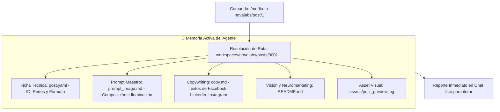

# 📘 MANUAL DE USUARIO: PUBLICACIONES E INFOGRAFÍAS CON IA (`media-post`)

Este manual está diseñado para que cualquier miembro del equipo de **Nova Labs** o de la agencia aprenda a crear, navegar, iterar y publicar piezas gráficas, infografías tecnológicas y artículos de autoridad (*Thought Leadership*) utilizando el framework **media-architect**.

---

## 🎯 1. ¿Qué es y Para Qué Sirve?

Mientras que los videos de corta duración (Reels/TikTok) son el imán de atención para frenar el scroll, **las publicaciones estáticas (infografías y carruseles)** son las herramientas clave para:
* **Explicar conceptos complejos** en esquemas visuales de 3 pasos.
* **Generar autoridad B2B** en LinkedIn y Facebook frente a empresarios y directores de tecnología.
* **Convertir leads en conversaciones privadas** de WhatsApp y mensajes directos.

El framework permite dos modalidades:
1. **Repropósito Transmedia:** Convertir un proyecto de video existente (ej. el spot de lanzamiento) en una infografía complementaria que hereda el mismo personaje, set y colores.
2. **Post Independiente:** Crear un post temático desde cero (ej. *Gobernanza de IA*, *Agentes para PyMEs*, etc.).

---

## 📂 2. Estructura de Archivos del Post

Todas las publicaciones se almacenan de forma ordenada dentro del Workspace activo:

```text
workspaces/[workspace_name]/posts/[ID_INCREMENTAL]-[slug]/
├── post.yaml            # Ficha técnica (ID, categoría, redes, proyecto vinculado)
├── prompt_image.md      # Prompt maestro en inglés para la IA de imagen
├── copy.md              # Textos persuasivos adaptados a cada red social
├── README.md            # Análisis de neuromarketing y estrategia de retención
└── assets/
    └── post_preview.jpg # Imagen generada y optimizada lista para revisión
```

---

## 🚀 3. Cómo Crear un Post Nuevo (`/media-post`)

Para generar una nueva publicación, interactúa con el agente en el chat usando el comando **`/media-post`**:

### Caso A: Derivado de un Proyecto de Video Activo
Si ya estás trabajando en un video (ej. `0001-lanzamiento-engineering-innovation`):
```text
/media-post
```
*El agente leerá automáticamente el guion del video, el actor (`lead-engineer`) y el laboratorio, y generará una infografía conectada con la historia.*

### Caso B: Creación de un Post Independiente
Si quieres crear un post sobre un tema nuevo para la marca:
```text
/media-post "Gobernanza de IA y Gestión de Riesgos en Empresas"
```
*El agente tomará el Brand Book del workspace y creará la pieza desde cero.*

---

## 🧭 4. Navegación y Re-apertura de Posts con `/media-in` (Guía Didáctica)

¿Qué pasa si publicaste un post la semana pasada o lo dejaste a medias y hoy necesitas ajustar el copy, cambiar el llamado a la acción o rediseñar la imagen?

No necesitas empezar de cero ni reescribir prompts. Usas el comando universal de navegación del framework: **`/media-in`**.

### 📌 A. La Sintaxis Universal
El comando **`/media-in`** cuenta con un conector inteligente `/post/` que te permite saltar directo a cualquier publicación de cualquier workspace:

```text
/media-in [workspace]/post/[id]
```

#### Ejemplos de uso rápido (Auto-Padding Inteligente):
El sistema es flexible y reconoce números simples sin que tengas que escribir manualmente los cuatro dígitos:
* **`/media-in novalabs/post/1`** ➔ *(Carga automáticamente `workspaces/novalabs/posts/0001-...`)*
* **`/media-in novalabs/post/01`** ➔ *(Carga automáticamente `workspaces/novalabs/posts/0001-...`)*
* **`/media-in novalabs/post/0001`** ➔ *(Carga exacta por ID)*
* **`/media-in novalabs/post/0001-mas-alla-del-prompt`** ➔ *(Carga directa por slug completo de carpeta)*

> 💡 **En lenguaje natural:** Si no recuerdas el comando exacto, simplemente dile al agente:  
> *«Quiero trabajar en el post 1 de novalabs»* o *«Carga la publicación sobre Más allá del prompt de Nova Labs»*.

---

### 🔍 B. ¿Qué Ocurre "Detrás de Cámaras" al Ejecutar `/media-in`?
Cuando ejecutas **`/media-in novalabs/post/1`**, el Agente realiza 5 acciones automáticas en milisegundos:



1. **Lee `post.yaml`:** Identifica qué tipo de post es, su categoría (educativo, técnico, comercial) y las redes a las que apunta.
2. **Lee `prompt_image.md`:** Carga el prompt en inglés que se usó para generar el fondo, tipografía, paleta de colores y logos.
3. **Lee `copy.md`:** Carga los textos para Facebook, LinkedIn e Instagram.
4. **Detecta los Assets en `assets/`:** Verifica si ya existe una imagen generada (`post_preview.jpg`) y su peso optimizado.
5. **Te entrega un reporte en el chat:** Te resume el estado del post y te pregunta de inmediato qué deseas modificar.

---

### 🔄 C. Video vs. Post: ¿Cómo se diferencia `/media-in`?

| Si quieres trabajar en... | Escribes en el Chat | Qué archivos carga el Agente en su contexto |
| :--- | :--- | :--- |
| 🎬 **Un Proyecto de Video** | **`/media-in novalabs/1`** *(o `novalabs/0001`)* | `manifest.yaml`, `script.md`, `storyboard.md`, `render/` y clips de video. |
| 📱 **Una Publicación / Infografía** | **`/media-in novalabs/post/1`** | `post.yaml`, `prompt_image.md`, `copy.md`, `assets/post_preview.jpg`. |
| 🏢 **Solo el Workspace (General)** | **`/media-in novalabs`** | `workspace.yaml`, `AGENTS.md`, personajes del Lore y Brand Book. |

---

### 🛠️ D. Tutorial Paso a Paso: El Ciclo de Iteración de un Post Existente

Imagina que tu post `0001` ya fue publicado en LinkedIn, pero ahora quieres lanzarlo en Facebook y adaptar el copy:

1. **Paso 1: Entrar al post.**  
   Escribe en el chat:  
   > **`/media-in novalabs/post/1`**
2. **Paso 2: Pedir la modificación específica.**  
   > *"Quiero adaptar el texto para Facebook. Quita los tecnicismos complicados, usa viñetas con emojis y no uses asteriscos en los títulos."*
3. **Paso 3: Modificar la imagen si es necesario.**  
   > *"Cambiemos el fondo: en lugar de noche, que sea una oficina de día muy iluminada y añade el logo de Nova Labs en la mampara."*  
   *(El agente actualizará `prompt_image.md` y regenerará la vista previa en `assets/post_preview.jpg`).*
4. **Paso 4: Congelar la nueva versión.**  
   > **`/media-commit`** *"Ajuste de copy para Facebook y luz diurna en post 0001"*

---

## 💬 5. Cómo Interactuar con el Agente para Iterar (Ejemplos Didácticos)

No te conformes con la primera versión. El agente actúa como tu Director de Arte y Copywriter en tiempo real. Puedes pedirle ajustes con instrucciones naturales:

| Lo que quieres cambiar | Qué decirle al agente (Ejemplo) |
| :--- | :--- |
| **Cambiar el ambiente** | *"Quiero que la oficina sea más luminosa y diurna, no tan oscura como una cueva de hacker."* |
| **Ajustar la tipografía** | *"Cambiemos el título a una tipografía moderna Sans-Serif limpia, sin serifas."* |
| **Corregir la composición** | *"El panel holográfico está tapando el cuello del personaje; muévelo al centro y pon al expositor al costado."* |
| **Branding en el entorno** | *"Integra el logo de Nova Labs grabado en la pared de vidrio esmerilado de fondo."* |
| **Ajustar el tono del copy** | *"El texto suena muy presumido; hazlo más humilde, educativo y quita los asteriscos para Facebook."* |

---

## 🎨 6. Guía de Generación de Imágenes (Google Flow / Ideogram / Flux)

Cuando vayas a generar la imagen final en herramientas externas como **Google Flow (Nano Banana Pro)**, **Ideogram v2** o **Flux**, sigue estas **3 reglas obligatorias**:

### ⚠️ Regla 1: MODO IMAGEN (Nunca Video)
* Verifica siempre en la herramienta que el selector esté en **`Imagen`** (no en `Video · 720p · 8s`).
* Configura la relación de aspecto en **`3:4`** o **`Vertical`**.

### ⚠️ Regla 2: QUÉ Copiar y QUÉ NO Copiar de `prompt_image.md`
* ✅ **SÍ COPIAR:** El texto descriptivo en inglés y el Negative Prompt.
* ❌ **NO COPIAR:** Las líneas de metadatos de Markdown:
  ```text
  ---
  post_id: "0001"
  type: "infographic_image_prompt"
  ...
  ---
  # PROMPT IMAGEN...
  ```
  *(Pegar esas líneas confunde a la IA y puede hacer que dibuje caracteres rotos en la imagen).*

### 🖼️ Regla 3: Imágenes de Referencia
* Si la publicación incluye a un personaje del Lore (ej. `@lead-engineer`), adjunta su foto de referencia:  
  `workspaces/[workspace]/characters/[personaje]/[personaje]_reference.jpg`.
* Si quieres que el logo aparezca grabado en el vidrio o la pared, adjunta también:  
  `workspaces/[workspace]/assets/brand/logo.png`.

---

## ✍️ 7. Reglas de Oro de Copywriting para Redes Sociales

### A. Para Facebook e Instagram: ¡CERO ASTERISCOS!
* En Facebook, los asteriscos de Markdown `**` **NO se convierten en negritas**. Se publican literalmente como `**Nivel 1**`, lo que se ve descuidado.
* **Solución del manual:** Usa **MAYÚSCULAS LIMPIAS** en los títulos y viñetas con emojis:
  * ❌ *Incorrecto:* `**Nivel 1: USO**`
  * ✅ *Correcto:* `1️⃣ NIVEL 1: USO (Prompts Aislados)`

### B. Tono Sin Presunción (Humildad con Autoridad)
Para conectar con empresarios y clientes reales, evita el lenguaje arrogante o frases de vendedor insistente:
* ❌ *Evitar:* *"La mayoría de personas tiene resultados mediocres"* / *"Videos baratos"* / *"Jugar en las grandes ligas"*.
* ✅ *Usar:* *"Resultados genéricos o poco profesionales"* / *"Piezas estándar que pasan desapercibidas"* / *"Destacar con autoridad en tu sector"*.

### C. Para LinkedIn (Thought Leadership)
* Inicia con una pregunta o paradoja reflexiva.
* Desglosa el contenido en 3 aprendizajes o etapas de madurez.
* Cierra siempre con una **pregunta abierta** para fomentar el debate en comentarios (esto dispara el alcance del algoritmo de LinkedIn).

---

## 📐 8. Dimensiones y Formatos de Publicación

| Red Social | Formato Óptimo | Proporción | ¿Por qué? |
| :--- | :--- | :--- | :--- |
| **Facebook (Muro)** | 1080 x 1440 px | **3:4** | Ocupa el 80% de la pantalla del celular sin recortarse. |
| **Instagram (Feed)** | 1080 x 1350 px | **4:5** | Formato vertical oficial para máxima retención de scroll. |
| **LinkedIn (Feed)** | 1080 x 1350 px | **4:5 o 3:4** | Logra hasta un 40% más de clics que una imagen horizontal. |
| **WhatsApp Status** | 1080 x 1920 px | **9:16** | Pantalla completa para historias y estados móviles. |

*Nota: La imagen generada por **`/media-post`** en proporción 3:4 es **directa para publicar** en Facebook, Instagram y LinkedIn sin requerir recortes.*

---

## ✅ 9. Checklist Antes de Dar Clic en "Publicar"

Antes de lanzar una publicación a las redes:
- [ ] ¿La imagen tiene una tipografía limpia y unificada (Sans-Serif)?
- [ ] ¿El logo de la empresa se ve integrado naturalmente en el entorno?
- [ ] ¿El texto de Facebook NO tiene asteriscos sueltos?
- [ ] ¿El tono es constructivo, empático y profesional (cero presunción)?
- [ ] ¿El llamado a la acción dirige a WhatsApp, DM o enlace en el perfil?
- [ ] ¿Se ejecutó **`/media-commit`** para versionar la pieza en Git?
