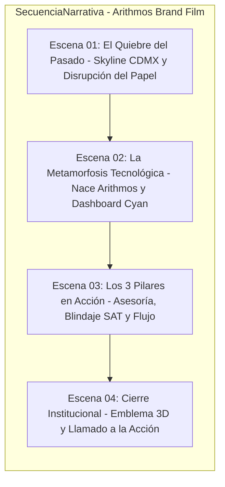

# 🎬 CONTEXTO DEL PROYECTO: Arithmos Brand Film - La Nueva Era de tu Contabilidad (0001)

Este archivo define la dirección de arte, estándares cinematográficos y reglas narrativas específicas para el proyecto **`0001-relanzamiento-marca-nueva-era`** en el workspace **`arithmos`**.

---

## 1. 📋 METADATA DEL PROYECTO
- **ID:** `0001-relanzamiento-marca-nueva-era`
- **Título Oficial:** "Arithmos Brand Film: La Nueva Era de tu Contabilidad"
- **Tipo de video:** `commercial_spec_ad` (Brand Manifesto / Spot Institucional de Relanzamiento)
- **Duración objetivo:** 28–30 segundos (Dividido en 4 escenas de 7–8 segundos optimizadas para Google Flow VEO 3.1)
- **Formato:** Master vertical `9:16` (con zona segura central adaptable a `16:9` para Web Header y pantallas de escritorio)
- **Plataformas de destino:** Video fijado en Facebook, hero video de [arithmos.com.mx](https://www.arithmos.com.mx/), Instagram Reels, TikTok y tarjeta de presentación en WhatsApp Business.
- **Métricas Esperadas:** Engagement Score: 49/50 | Retención: >85% en los primeros 5 segundos.

---

## 2. 🎯 VISIÓN CREATIVA Y OBJETIVO ESTRATÉGICO
El objetivo del film es generar una ruptura inmediata con la percepción del despacho contable tradicional en México (asociado a lentitud, papeles polvorientos, tecnicismos intimidantes y miedo a auditorías del SAT).

Arithmos se posiciona visual y narrativamente como la **marca de estatus tecnológico** que combina:
1. **Disciplina Fiscal Inquebrantable:** Cumplimiento certero ante el SAT y CFDI 4.0.
2. **Tecnología en Tiempo Real:** Dashboards claros que permiten tomar decisiones financieras ágiles.
3. **Paz Mental Absoluta:** La tranquilidad de saber que tus números trabajan a tu favor, liberando tiempo y energía para el crecimiento del negocio.

---

## 3. 🚫 REGLAS NARRATIVAS Y DE RODAJE OBLIGATORIAS
- **Cero Lip-Sync (Sin personajes hablando a cámara):** Queda **estrictamente prohibido** que los personajes hablen o muevan los labios en pantalla. La presencia humana es 100% visual y actitudinal: miradas serenas, micro-gestos de alivio, desplazamientos seguros en el set y revisión colaborativa de pantallas.
- **Voiceover Ejecutivo Único:** Toda la narrativa se sostiene en una locución en off masculina (`mexican_male_professional_calm`), con dicción impecable, calidez empática y autoridad serena.
- **Diseño Sonoro & Foley ASMR:** Downtempo electrónico minimalista con piano neoclásico, pulsos digitales que evocan flujo de datos y foley de alta gama (clics mecánicos táctiles, taza de café en roble ahumado, respiración de alivio).
- **Estándar Fotográfico de Lujo:** Estética editorial Fintech / Silicon Valley ambientada en rascacielos de Paseo de la Reforma (CDMX), sensor de medio formato simulado (Hasselblad H6D-100c / ARRI Alexa Mini LF), 85mm f/1.8, contrastes *chiaroscuro tech* con luz cálida de atardecer y acentos LED en cyan neón (`#00E5FF`) y azul zafiro (`#007BBF`).

---

## 4. 📐 ESTRUCTURA DE LAS 4 ESCENAS (7-8 SEGUNDOS C/U)

### Escena 1: El Quiebre del Pasado (0:00 - 0:06)
- **Visual:** Plano macro extremo descendente a un sello rojo descolorido sobre pilas de facturas caóticas y calculadora beige sucia. A los 2 segundos, un pulso lumínico en cyan neón (`#00E5FF`) detona y desintegra el papel; la cámara ejecuta un *pull-back* hiper-rápido continuo atravesando el cristal y abriéndose a la majestuosa vista aérea de Paseo de la Reforma al atardecer crepuscular.
- **Audio & Foley:** Zumbido eléctrico cortado en seco por estallido sonoro digital (*shockwave & crystal swoosh*) que se abre al rumor lejano de la urbe.
- **Locución en Off:**
  > *"En México los negocios crecen rápido... pero la contabilidad se quedó en el pasado."*

### Escena 2: La Metamorfosis Tecnológica — Nace Arithmos (0:06 - 0:13)
- **Visual:** Movimiento orbital bajo con efecto paralaje alrededor de un escritorio de roble oscuro ahumado. La laptop ultradelgada de aluminio oscuro despierta mostrando barras analíticas fluidas en cyan neón y azul sobre fondo antracita (`#1E222A`). La cámara revela en primer plano el [[emblema-arithmos]] (anillo ensō en titanio cepillado) con destello anamórfico sutil.
- **Audio & Foley:** Chasquido táctil de encendido digital y click nítido de teclado táctil (*CHIK*).
- **Locución en Off:**
  > *"Bienvenido a Arithmos. Estrategia fiscal y tecnología en tiempo real para tu negocio."*

### Escena 3: Los 3 Pilares en Acción (0:13 - 0:21)
- **Visual:** Plano secuencia cinematográfico continuo sin cortes con técnica de *dolly-in lateral y snap rack focus*: inicia en plano detalle de la mano del [[emprendedor-tech]] levantando una taza humeante con serenidad; se desliza en paneo fluido hacia la tablet donde resalta la marca animada *"CFDI 4.0 Validado · SAT 100%"*, y sin detenerse ejecuta un *rack focus* al fondo revelando al [[consultor-arithmos]] y al emprendedor cruzando miradas de confianza y complicidad corporativa.
- **Audio & Foley:** Deslizamiento suave sobre madera noble, confirmación armónica en la tablet (*CHIME cristalino*) y exhalación silenciosa de alivio.
- **Locución en Off:**
  > *"Cumplimiento certero ante el SAT, reportes claros y la tranquilidad para tomar el control."*

### Escena 4: Cierre Institucional & Llamado a la Acción (0:21 - 0:29)
- **Visual:** Fondo azul marino abisal (`#0B192C`) con sutil bokeh de partículas luminosas en suspensión. Giro orbital 3D lento con aproximación frontal: las estrías ensō del círculo de Arithmos convergen en titanio 3D con fulgor cyan neón. El logotipo tipográfico **A R I T H M O S** emerge con tipografía geométrica espaciada y datos de contacto de conversión directa.
- **Audio & Foley:** Resonancia metálica fina de titanio seguida del acorde resolutivo en piano de cola.
- **Locución en Off:**
  > *"Tus números en orden. Tu tranquilidad en marcha. Diagnóstico sin costo en arithmos.com.mx. Arithmos."*

---

## 5. 👥 CASTING Y ELEMENTOS CLAVE
- **`emprendedor-tech`:** Empresario mexicano contemporáneo (30-38 años), vestimenta *smart casual* impecable (camisa abierta de lino o jersey oscuro), mirada enfocada, actitud serena y liberada.
- **`consultor-arithmos`:** Asesor fiscal moderno (32-40 años), traje sastre contemporáneo sin corbata o blazer azul marino, expresión empática y de alta solvencia técnica.
- **`laptop-fintech`:** Ultrabook en aluminio oscuro exhibiendo interfaz financiera limpia en cyan neón sobre fondo antracita.
- **`emblema-arithmos`:** Escultura 3D en titanio del círculo en remolino de Arithmos con halo de luz azul.
- **`taza-cafe-roble`:** Taza cerámica artesanal de autor en escritorio de madera noble.

---

## 6. 🛠️ FLUJO DE PRODUCCIÓN
Para avanzar con las siguientes etapas de este proyecto, utiliza:
1. **`/media-script`**: Para generar y pulir el guion técnico definitivo en formato cinematográfico.
2. **`/media-casting`**: Para generar las hojas de referencia visuales de los personajes.
3. **`/media-set`**: Para fijar el set base de oficinas corporativas en Paseo de la Reforma.
4. **`/media-storyboard`**: Para crear el tablero visual con prompts de imagen por escena.
5. **`/media-render`**: Para generar los prompts finales de video para Google Flow VEO 3.1.
