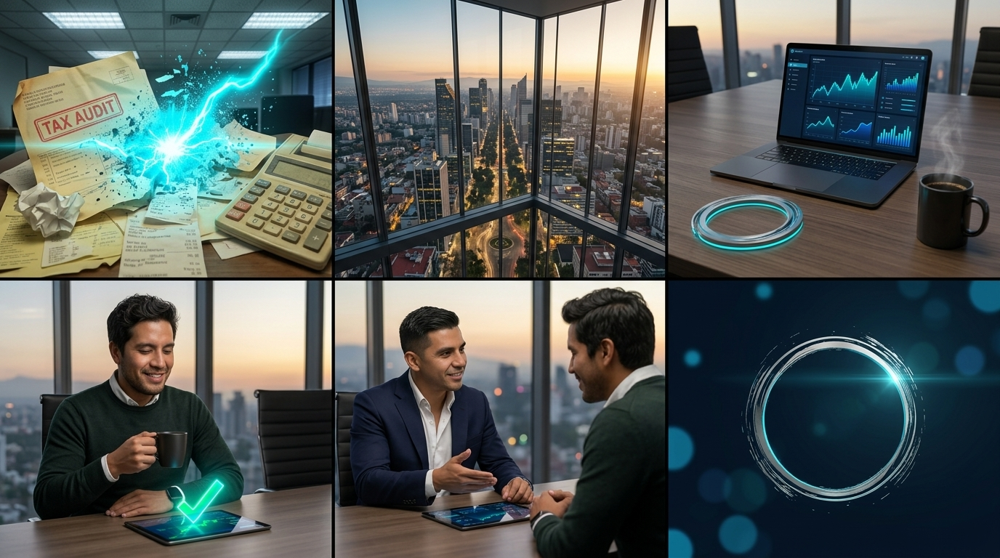

# STORYBOARD CINEMATOGRÁFICO: ARITHMOS BRAND FILM

**Proyecto:** `0001-relanzamiento-marca-nueva-era`  
**Workspace:** `arithmos` (Arithmos - Sinergia & Tecnología Contable)  
**Reparto (Lore):** [[emprendedor-tech]], [[consultor-arithmos]] (Presencia 100% Visual / No Dialogantes)  
**Props (Lore):** [[laptop-fintech]], [[emblema-arithmos]], [[taza-cafe-roble]]  
**Formato:** Master Vertical 9:16 (con safe area central adaptable a 16:9 para Web Header)  
**Duración Total:** 29 Segundos  
**Estilo Visual:** High-End Fintech Spec Ad, Silicon Valley / Paseo de la Reforma modern executive aesthetic, chiaroscuro tech lighting, warm sunset window light contrasted with neon cyan (`#00E5FF`) and royal blue (`#007BBF`) LED accents, Hasselblad H6D-100c / ARRI Alexa Mini LF cinematic frame, 85mm f/1.8 lens, shallow depth of field, 8k resolution photorealistic.  

---

## 🎨 Bloque 1: Tomas 1 a 4 (Secuencia Completa)

### Prompt Visual Global del Bloque
*LORE GLOSSARY:*  
*[[consultor-arithmos]] = An authentic, charismatic Latin American male senior fintech consultant in his early-to-mid 30s (strictly matching reference image 1), with clean short dark hair, well-groomed, wearing a tailored midnight-navy blue blazer, open-collar crisp white dress shirt, charcoal gray tailored trousers, and polished tobacco-brown leather dress shoes.*  
*[[emprendedor-tech]] = An authentic modern Mexican startup founder and tech entrepreneur in his early 30s (strictly matching reference image 2), with textured dark hair, light neat stubble, wearing a premium dark forest-green crewneck merino sweater over a white collar, slim dark navy chinos, clean white leather designer sneakers, holding a dark handcrafted ceramic coffee mug.*  
*[[laptop-fintech]] = Sleek dark aluminum laptop displaying a state-of-the-art financial dashboard interface with minimalist tax return metrics, cash-flow line graphs, and clean analytical charts in glowing neon cyan (#00E5FF) and royal blue on a dark slate background (#1E222A).*  
*[[emblema-arithmos]] = A precision-machined 3D circular dynamic swirl emblem of Arithmos (strictly matching brand logo in reference image 3), sculpted in brushed titanium with elegant edge accents of glowing cyan LED light (#00E5FF) and deep metallic navy blue.*  
*[[taza-cafe-roble]] = Handcrafted dark matte ceramic coffee mug on a solid smoked oak desk with gentle faint steam.*  

*PROMPT:*  
*A 6-panel comic-style storyboard layout (2 rows of 3 panels), high-end fintech commercial spec ad style, 8k resolution, Hasselblad H6D-100c medium format and ARRI Alexa Mini LF cinematic frame, Paseo de la Reforma Mexico City corporate high-rise aesthetic, soft chiaroscuro tech lighting with twilight sunset and cyan LED accents.*  
*Panel 1: Extreme close-up shot of an obsolete chaotic office desk: a faded red tax audit stamp on crumpled yellowed papers and receipts, a worn beige plastic calculator under cold flickering fluorescent light; a vivid neon cyan (#00E5FF) energy shockwave is bursting in the center, disintegrating the papers into digital particles.*  
*Panel 2: Dramatic dynamic wide aerial pull-back view looking out through the floor-to-ceiling glass windows of a high-rise tower, showing the magnificent panoramic skyline of Paseo de la Reforma in Mexico City bathed in golden hour twilight with urban city lights beginning to glow.*  
*Panel 3: Low-angle dynamic orbital slider shot moving around a solid smoked oak conference desk. In the center, a dark aluminum laptop open displaying clean glowing neon cyan and deep blue financial charts on a dark interface; in the foreground corner rests the 3D brushed titanium Arithmos swirl emblem with cyan edge glow and a steaming dark ceramic coffee mug.*  
*Panel 4: Intimate cinematic medium shot inside the corporate boardroom. On the left, our casted Mexican tech entrepreneur matching reference image 2 in dark green sweater smiles with deep calm and relief while holding his coffee cup; in front of him on the table is an open tablet showing a bright glowing green and cyan checkmark reading 'CFDI 4.0 Validado - SAT 100%'.*  
*Panel 5: Medium cinematic two-shot with shallow depth of field. Our casted Latin American consultant matching reference image 1 in tailored navy blazer and open-collar white shirt sits beside the entrepreneur, gesturing cordially toward the financial metrics on the tablet; both exchange a warm nod of mutual trust and corporate victory with the twilight city view in soft background blur.*  
*Panel 6: Conceptual dark navy blue (#0B192C) studio frame with soft floating cyan bokeh lights. The 3D sculpted titanium circular swirl emblem of Arithmos hovers majestically in the center with subtle cyan lens flare and pristine brushed metallic reflections.*  
*CRITICAL: Do not include any text, letters, subtitles, words, or speech bubbles anywhere in the image. The image must be completely free of typography.*  

---

## 🎬 Desglose Técnico Toma por Toma

### Toma 1 (Hook: El Quiebre del Pasado)
- **Toma:** 1
- **Thumbnail (Visual):** Macro extremo descendente a un sello rojo descolorido sobre pilas de facturas caóticas y calculadora beige sucia. A los 2 segundos, un pulso lumínico en cyan neón (`#00E5FF`) detona en el centro desintegrando el papel; la cámara ejecuta un *pull-back* hiper-rápido continuo atravesando el cristal hacia la majestuosa vista aérea de Paseo de la Reforma al atardecer crepuscular. *(Paneles 1 y 2)*
- **Acción/Narrativa:** Gancho visceral de retención (0 a 3s) que rompe de golpe el dolor del papeleo obsoleto y abre la escala hacia la modernidad urbana de México.
- **Cámara y Fotografía:**
  - **Plano:** ECU (Extreme Close-Up) $\rightarrow$ Extreme Wide Aerial Shot / Lente 24mm-85mm f/1.8
  - **Movimiento de cámara:** Descendente acelerado con *pull-back* vertiginoso en reversa continua atravesando el ventanal
  - **Iluminación:** Contraste agresivo: de luz fluorescente fría parpadeante (5000K desoladora) a luz dorada crepuscular cálida de atardecer en Reforma (3200K) con destello cyan
  - **Color Grading:** Tonos desaturados y amarillentos en el pasado, abriéndose hacia negros profundos, dorado ámbar y cyan eléctrico
- **Duración:** 6s (0:00 - 0:06)
- **Audio/Voz en Off:** *(SFX Foley: Zumbido eléctrico cortado en seco por estallido sonoro digital SHOCKWAVE & CRYSTAL SWOOSH que se abre al rumor de la urbe)* "Haces crecer tu negocio todos los días... pero tu contabilidad te sigue frenando."
- **Transición:** Match Cut por velocidad y barrido lumínico hacia el escritorio de roble en Toma 2

---

### Toma 2 (Metamorfosis: Nace Arithmos)
- **Toma:** 2
- **Thumbnail (Visual):** Movimiento orbital bajo con efecto paralaje alrededor de un escritorio de roble oscuro ahumado. La laptop ultradelgada de aluminio espacial despierta: su pantalla cobra vida con una animación HUD ultralimpia de barras de flujo de caja y balances en cyan neón y azul zafiro sobre fondo antracita (`#1E222A`). La cámara revela en primer plano el [[emblema-arithmos]] (anillo ensō en titanio cepillado con retroiluminación cyan) que proyecta un destello anamórfico sutil, junto a la [[taza-cafe-roble]] humeante. *(Panel 3)*
- **Acción/Narrativa:** Presenta la solución tecnológica de Arithmos como un santuario de orden, modernidad y sofisticación ejecutiva.
- **Cámara y Fotografía:**
  - **Plano:** Low-Angle Orbital Medium / Lente 50mm f/1.4 Anamórfico
  - **Movimiento de cámara:** Arco orbital circular suave a baja altura con rotación de 60 grados alrededor del escritorio
  - **Iluminación:** *Chiaroscuro tech* con luz suave rasante de atardecer filtrada por el ventanal, combinada con el halo cyan del emblema y la pantalla
  - **Color Grading:** Roble ahumado profundo, titanio metálico satinado, cyan neón `#00E5FF` vibrante y reflejos dorados en cristal
- **Duración:** 7s (0:06 - 0:13)
- **Audio/Voz en Off:** *(SFX Foley: Chasquido táctil de encendido digital POWER UP suave y click nítido de teclado táctil CHIK)* "Bienvenido a Arithmos. Estrategia fiscal y tecnología en tiempo real para tu negocio."
- **Transición:** Panorámica continua con paneo de cámara (*pan-right*) hacia los personajes en Toma 3

---

### Toma 3 (Los 3 Pilares en Acción: Plano Secuencia Dinámico)
- **Toma:** 3
- **Thumbnail (Visual):** Plano secuencia en movimiento cinematográfico continuo sin cortes (técnica *dolly-in lateral con snap rack focus*): inicia en plano detalle cerrado de la mano del [[emprendedor-tech]] levantando la [[taza-cafe-roble]] humeante con serenidad; se desliza en paneo fluido hacia la tablet donde resalta la marca animada *"CFDI 4.0 Validado · SAT 100%"*, y sin detenerse ejecuta un *rack focus* al fondo revelando al [[consultor-arithmos]] y al emprendedor cruzando miradas de confianza y complicidad corporativa ante el gran ventanal. *(Paneles 4 y 5)*
- **Acción/Narrativa:** Articula visualmente los 3 pilares del servicio: asesoría estratégica personalizada, blindaje fiscal ante el SAT y paz mental para el empresario.
- **Cámara y Fotografía:**
  - **Plano:** Detail Shot $\rightarrow$ Medium Close-Up $\rightarrow$ Medium Two-Shot / Lente 85mm f/1.8 Master Prime
  - **Movimiento de cámara:** Dolly lateral continuo con trayectoria fluida y dos cambios de foco nítidos (*snap rack focus*) sin corte
  - **Iluminación:** Iluminación natural suave de sala de juntas corporativa; luz de relleno difusa en rostros resaltando textura de piel y nitidez de vestuario
  - **Color Grading:** Verde bosque de lana merino, azul marino del blazer sastre, tonos de piel naturales cálidos y cyan nítido en interfaces
- **Duración:** 8s (0:13 - 0:21)
- **Audio/Voz en Off:** *(SFX Foley: Deslizamiento suave sobre madera noble, confirmación armónica en tablet CHIME cristalino y exhalación silenciosa)* "Cumplimiento certero ante el SAT, reportes claros y la tranquilidad para tomar el control."
- **Transición:** Disolvencia dinámica con partículas cyan hacia el espacio conceptual de cierre en Toma 4

---

### Toma 4 (Cierre Institucional & Conversión)
- **Toma:** 4
- **Thumbnail (Visual):** Fondo azul marino abisal (`#0B192C`) con sutil bokeh de partículas luminosas en cyan flotando suavemente. Giro orbital 3D lento con aproximación frontal: las estrías ensō del círculo de Arithmos convergen en titanio 3D con fulgor cyan neón. El logotipo tipográfico **A R I T H M O S** emerge con tipografía geométrica espaciada y los datos de contacto de conversión directa. *(Panel 6)*
- **Acción/Narrativa:** Cierre de autoridad, memorabilidad de isotipo y llamada directa a la acción con oferta de diagnóstico gratuito.
- **Cámara y Fotografía:**
  - **Plano:** Conceptual Product Shot / Centrado Frontal / Lente 100mm Macro
  - **Movimiento de cámara:** Giro orbital lento de 15 grados con avance suave hacia el emblema central
  - **Iluminación:** Luz perimetral (*rim light*) en cyan neón sobre bordes de titanio, fondo en penumbra azul noche con partículas bokeh
  - **Color Grading:** Azul marino oscuro `#0B192C`, titanio metálico brillante, cyan neón `#00E5FF` y blanco puro
- **Duración:** 8s (0:21 - 0:29)
- **Audio/Voz en Off:** *(SFX Foley: Resonancia metálica fina de titanio y acorde de piano de cola en reverberación cálida)* "Tus números en orden. Tu tranquilidad en marcha. Diagnóstico sin costo en arithmos.com.mx. Arithmos."
- **Transición:** Fade to black suave y elegante
