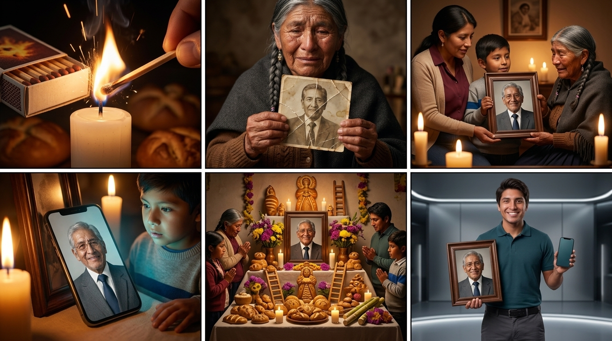
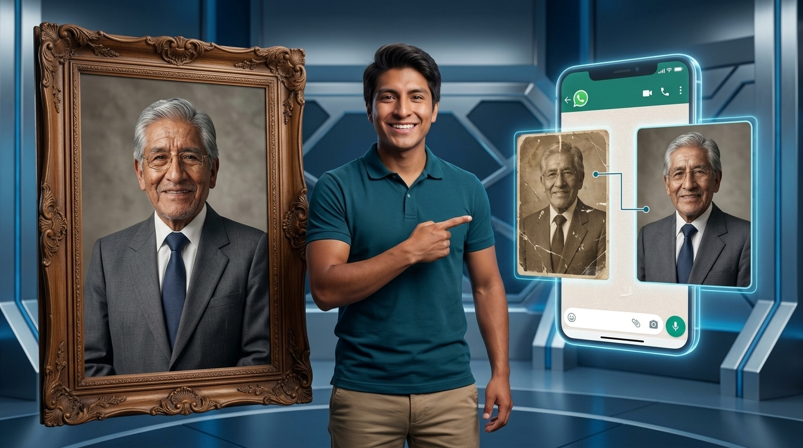

# STORYBOARD: Todos los Santos - La Última Vez Que Lo Viste Sonreír (0003)

**Proyecto:** Todos los Santos - La Última Vez Que Lo Viste Sonreír (0003)  
**Workspace:** NOVA HOME & TECH  
**Reparto (Lore):** Arturo (portavoz de NOVA), Doña Rosa (abuela, 72 años), María (hija, 42 años), Mateo (nieto, 9 años)  
**Aspect Ratio:** 9:16 (Vertical)  
**Duración Total:** 45 segundos (7 Tomas, ninguna supera los 8 segundos)  

---

## 🎨 BLOQUE 1: TOMAS 1 A 6 (NARRATIVA EMOCIONAL Y REVELACIÓN)

### Toma 1 (Hook Dinámico)
- **Toma:** 1
- **Thumbnail (Visual):** Macro en cámara lenta a 60fps de una cerilla de madera rascando la caja con chispas fulgurantes que encienden una vela gruesa en chiaroscuro.
- **Acción/Narrativa:** Hook visual dinámico sin inicio estático. La chispa y el fuego iluminan sombras donde se adivinan panes ceremoniales de Todos los Santos.
- **Cámara y Fotografía:**
  - **Plano:** ECU (Extreme Close-Up / Macro) / Lente 100mm Macro f/2.8
  - **Movimiento de cámara:** Fijo con micro-vibración orgánica
  - **Iluminación:** Chiaroscuro dramático, resplandor dorado de llama parpadeante
  - **Color Grading:** Sombras densas, cálido dorado profundo
- **Duración:** 0:00 - 0:03 (3s)
- **Audio/Voz en Off:** *(SFX: Raspe y chisporroteo nítido de cerilla en cámara lenta)* *(Voz en off profunda, susurrada, tono melancólico)*: "Dicen que con los años... el cerebro empieza a olvidar su sonrisa."
- **Transición:** Hard Cut rápido a plano cerrado

### Toma 2 (El Dolor / Foto Deteriorada)
- **Toma:** 2
- **Thumbnail (Visual):** Manos ancianas con venas marcadas sostienen una fotografía sepia doblada, rota y descolorida con manchas amarillas de humedad.
- **Acción/Narrativa:** Exposición del dolor y el paso del tiempo. Doña Rosa mira con tristeza y ojos humedecidos el retrato maltratado de su esposo difunto.
- **Cámara y Fotografía:**
  - **Plano:** CU (Close-Up) a las manos y MCU (Medium Close-Up) a Doña Rosa / Lente 50mm f/1.4
  - **Movimiento de cámara:** Slow Tilt-Up desde las manos temblorosas hacia su rostro
  - **Iluminación:** Soft candlelight lateral, sombras melancólicas
  - **Color Grading:** Tonos sepia lavados en la foto, calidez nostálgica en la piel
- **Duración:** 0:03 - 0:09 (6s)
- **Audio/Voz en Off:** *(Música de cuerdas melancólica suave)*: "Y esa foto que guardas con tanto amor... casi ya no se puede ver."
- **Transición:** Cut to Black (0.5s) con Silencio Total

### Toma 3 (El Silencio de Caída y Revelación 8K)
- **Toma:** 3
- **Thumbnail (Visual):** Manos jóvenes colocan un portarretratos de madera noble con la foto del abuelo totalmente restaurada en ultra-alta definición 8K.
- **Acción/Narrativa:** Catarsis y reset dopaminérgico con el Silencio de Caída. La abuela jadea conmovida y sonríe entre lágrimas al ver la nitidez y vida en la mirada del abuelo.
- **Cámara y Fotografía:**
  - **Plano:** MS (Medium Shot) / Lente 35mm f/1.4
  - **Movimiento de cámara:** Push-In suave hacia la emoción de la abuela
  - **Iluminación:** Golden Hour interior, resplandor cálido de velas
  - **Color Grading:** Tonos dorados cinematográficos ricos, piel luminosa
- **Duración:** 0:09 - 0:16 (7s)
- **Audio/Voz en Off:** *(0:09-0:10: SILENCIO TOTAL)* *(0:10+: Respiro contenido de la abuela, entra piano emotivo y cálido)*: "Hasta que la tecnología te devuelve su mirada exacta..."
- **Transición:** Smooth Pan hacia el celular en la mesa

### Toma 4 (El Retrato Cobra Vida - Teal & Orange)
- **Toma:** 4
- **Thumbnail (Visual):** Plano detalle del teléfono móvil junto al cuadro; la fotografía restaurada cobra vida pestañeando y sonriendo con ternura y naturalidad.
- **Acción/Narrativa:** Presentación de la animación hiper-realista. El resplandor cian de la pantalla ilumina el rostro maravillado de Mateo mientras la abuela contempla la sonrisa viva de su esposo.
- **Cámara y Fotografía:**
  - **Plano:** CU (Close-Up) al teléfono y rostro de Mateo / Lente 50mm f/1.8
  - **Movimiento de cámara:** Smooth Push-In diagonal
  - **Iluminación:** Teal & Orange cinematográfico (luz dorada ambiental de velas + resplandor cian #06C4BF de la pantalla en los ojos)
  - **Color Grading:** Teal & Orange contrastado de alta gama comercial
- **Duración:** 0:16 - 0:23 (7s)
- **Audio/Voz en Off:** *(Voz en off femenina conmovida)*: "...y sientes, por un segundo, que vuelve a estar presente."
- **Transición:** Slow Dissolve a plano general del altar

### Toma 5 (Presencia en la Mesa Tradicional)
- **Toma:** 5
- **Thumbnail (Visual):** Plano general cinematográfico de la mesa tradicional de Todos los Santos (tantawawas, cañas, flores moradas/amarillas, velas) con el cuadro presidiendo el centro.
- **Acción/Narrativa:** Anclaje cultural y solemne. La familia contempla en paz el altar con la memoria honrada con máxima dignidad.
- **Cámara y Fotografía:**
  - **Plano:** WS (Wide Shot) cinematográfico / Lente 24mm f/2.8
  - **Movimiento de cámara:** Slow Dolly In hacia el cuadro central
  - **Iluminación:** Múltiples fuentes de luz cálida de velas y candelabros
  - **Color Grading:** Paleta ceremonial boliviana rica (dorado de panes, morado y amarillo de flores)
- **Duración:** 0:23 - 0:30 (7s)
- **Audio/Voz en Off:** *(Música orquestal emotiva en crescendo)*: "Este 1 y 2 de noviembre, honra su memoria como verdaderamente merece estar."
- **Transición:** Match-Cut fluido (el marco del altar pasa a las manos de Arturo)

### Toma 6 (Match-Cut hacia Arturo / Explicación de Servicio)
- **Toma:** 6
- **Thumbnail (Visual):** Arturo en set comercial moderno sosteniendo ese mismo marco de madera noble y un smartphone mostrando la animación.
- **Acción/Narrativa:** Continuidad perfecta entre emoción y propuesta comercial. Arturo explica los entregables (digital y físico enmarcado) con energía empática y profesional.
- **Cámara y Fotografía:**
  - **Plano:** MCU (Medium Close-Up) / Lente 85mm f/1.8
  - **Movimiento de cámara:** Push-In comercial suave
  - **Iluminación:** High-End Commercial studio lighting con sutil rim light cian
  - **Color Grading:** Clean commercial neutral con contraste elegante
- **Duración:** 0:30 - 0:37 (7s)
- **Audio/Voz en Off:** *(Arturo habla a cámara con convicción y empatía)*: "En NOVA restauramos, animamos e imprimimos las fotos de tus seres queridos con Inteligencia Artificial. Entrega digital o cuadro físico enmarcado listo para tu mesa."
- **Transición:** Dynamic Whip Pan hacia la pantalla interactiva

### Prompt Visual Global (Bloque 1: Tomas 1-6)

*LORE GLOSSARY:*  
*[arturo] = 28-year-old Bolivian tech guide matching reference image, optimistic and approachable, neat dark hair, friendly charismatic face, smart casual dark teal polo shirt, commercial studio lighting.*  
*[dona_rosa] = 72-year-old indigenous Bolivian grandmother, weathered gentle face with deep natural wrinkles, warm dark eyes with tears of emotion, grey braided hair, wearing a traditional dark knit shawl.*  
*[maria] = 42-year-old Bolivian woman, caring daughter, humble modern clothing, warm respectful expression.*  
*[mateo] = 9-year-old Bolivian boy, curious expressive eyes, dark short hair, standing near his grandmother.*  
*[abuelo] = 75-year-old Bolivian grandfather in vintage portrait, kind proud eyes, gentle serene smile.*  

*PROMPT:*  
*Ultra-realistic, cinematic High-End Commercial, dramatic chiaroscuro lighting, warm candlelight, deep nostalgic atmosphere, shot on ARRI Alexa 65, 8k resolution. A 6-panel comic-style storyboard layout (2 rows of 3 panels). Authentic Bolivian home interior during Todos los Santos festival.*  
*Panel 1: Extreme macro shot of a wooden matchstick violently scraping the side of a matchbox with glowing fiery sparks, lighting a thick white candle wick, warm flame flickering in chiaroscuro lighting with blurred silhouettes of ceremonial bread in background.*  
*Panel 2: Close-up of elderly hands belonging to [dona_rosa] holding a damaged vintage sepia photograph with deep diagonal cracks, yellowed water stains, faded washed-out colors and blurred texture. [dona_rosa] has tearful eyes and emotional expression.*  
*Panel 3: Medium shot in warm candlelight. [maria] and [mateo] gently present an elegant dark wooden picture frame to [dona_rosa]. The photo inside is completely restored in ultra-high 8k definition showing [abuelo] with sharp crystal-clear eyes, authentic warm skin tones and fine details. [dona_rosa] gasps with touched joyful tears.*  
*Panel 4: Close-up of a modern smartphone resting next to the frame. The warm golden candlelight reflects off the phone screen while a soft subtle cyan glow illuminates [mateo]'s amazed face. On screen, [abuelo] has subtle lifelike micro-expressions, gentle blinking eyes and a warm reassuring smile.*  
*Panel 5: Wide cinematic shot of the traditional Bolivian Todos los Santos altar table filled with golden tantawawas bread figurines, bread ladders, purple and yellow flowers, sugar cane, and glowing candles. The restored wooden frame of [abuelo] presides proudly in the center as the family gathers in peaceful reverence.*  
*Panel 6: Seamless match-cut transition. Medium shot of [arturo] in a sleek high-end studio holding that exact elegant wooden picture frame in one hand and presenting a smartphone in the other, smiling warmly and persuasively toward the camera with charismatic professional posture.*  
*CRITICAL: Do not include any text, letters, subtitles, words, or speech bubbles anywhere in the image. The image must be completely free of typography.*  

---

## 🎨 BLOQUE 2: TOMA 7 (CIERRE COMERCIAL Y LLAMADO A LA ACCIÓN)

### Toma 7 (CTA y Cierre de Urgencia)
- **Toma:** 7
- **Thumbnail (Visual):** Arturo señala con dinamismo hacia la interfaz holográfica de WhatsApp que muestra la transformación de la foto sepia rota del abuelo a un retrato 8K nítido, junto a un cuadro enmarcado con el retrato físico del abuelo listo para entrega.
- **Acción/Narrativa:** Llamado a la acción de baja fricción y alta urgencia. Arturo actúa estrictamente como presentador/guía; el sujeto homenajeado en la demostración digital y el cuadro físico es el abuelo. Se enfatiza la fecha límite del 31 de octubre y envíos garantizados a toda Bolivia.
- **Cámara y Fotografía:**
  - **Plano:** MS (Medium Shot) / Lente 50mm f/2.0
  - **Movimiento de cámara:** Fijo con micro-punch in al señalar el botón
  - **Iluminación:** High-End Commercial studio con acentos holográficos cian (#06C4BF de NOVA)
  - **Color Grading:** Vibrante y comercial, alta definición publicitaria
- **Duración:** 0:37 - 0:45 (8s)
- **Audio/Voz en Off:** *(Arturo)*: "Envíanos tu foto por WhatsApp hoy mismo para una muestra gratis. Cupos limitados antes del 31 de octubre. ¡Toca el botón y asegura tu recuerdo!"
- **Transición:** Fade to Black con logo oficial de NOVA HOME & TECH

### Prompt Visual Global (Bloque 2: Toma 7)

*LORE GLOSSARY:*  
*[arturo] = 28-year-old Bolivian tech guide matching reference image, optimistic and approachable, neat dark hair, friendly charismatic face, smart casual dark teal polo shirt, commercial studio lighting.*  
*[abuelo] = 75-year-old Bolivian grandfather in vintage portrait, kind proud eyes, silver-gray hair, dark formal suit.*  

*PROMPT:*  
*Ultra-realistic, cinematic High-End Commercial, dramatic chiaroscuro studio lighting, shot on ARRI Alexa 65, 8k resolution. A single-panel commercial storyboard layout. [arturo] stands with an energetic, friendly and persuasive posture in a modern high-tech studio. He points proudly toward a glowing floating holographic smartphone displaying a WhatsApp mockup. In the demonstration, a worn damaged vintage sepia photo of [abuelo] is transformed into an ultra-detailed 8K restored portrait. In a large ornate wooden frame next to Arturo, the physical printed portrait of [abuelo] is displayed in lifelike detail. [arturo] is strictly the presenter; the restored subject inside the floating screen and frame is strictly [abuelo]. CRITICAL: Do not include any text, letters, subtitles, words, or speech bubbles anywhere in the image. The image must be completely free of typography.*  

