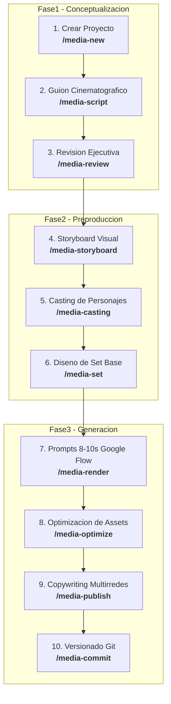

# Workspace: Nova Labs Bolivia (`novalabs`)

> **ENGINEERING INNOVATION** · *La tecnología detrás del éxito.*
> 
> Agencia tecnológica boliviana de alta gama especializada en inteligencia artificial, producción audiovisual cinematográfica, desarrollo web a medida y restauración visual.

---

## 🏢 Descripción General

**Nova Labs Bolivia** opera desde Tiquipaya (Cochabamba, Bolivia) brindando soluciones digitales de calidad de agencia a precios accesibles para PyMEs y emprendedores de todo el país. Fundada por **Liz Andrea Ramos Huarichi** y **Henry Alejandro Taby Zenteno** (Ingenieros de Sistemas de UMSA y UCATEC), la marca fusiona la disciplina de la ingeniería de software con la estética cinematográfica y el neuromarketing de conversión.

### Servicios Principales
1. **Paquetes Mensuales de Video con IA:** Suscripción mensual recurrente de contenido en video de alta retención para TikTok, Instagram y WhatsApp.
2. **Restauración y Animación de Fotografías Antiguas:** Rescate de memorias familiares a 8k con movimiento realista (campañas estacionales clave como Todos Santos y Día de la Madre).
3. **Catálogos Web a Medida:** Plataformas interactivas para tiendas y PyMEs optimizadas para conversión.
4. **Fotografía de Producto con IA:** Modelado, sets virtuales y macrofotografía de productos para e-commerce.
5. **Homenajes y Videos para Eventos:** Piezas emotivas cinematográficas para aniversarios, bodas, 15 años y legados familiares.

---

## 🎨 Identidad de Marca Rápida

| Elemento | Especificación |
|---|---|
| **Colores Principales** | Negro Profundo (`#0A0A0A`), Blanco (`#FFFFFF`), Teal Cian Brillante (`#00BCD4`), Cian Glow (`#40E0FF`) |
| **Tipografía** | Montserrat (Black 900 / Bold 700) para títulos; Inter (Regular 400 / Medium 500) para texto |
| **Taglines** | Oficial: *"ENGINEERING INNOVATION"* · Local: *"La tecnología detrás del éxito."* |
| **Sitio Web & Contacto** | novabo.app · novabo.app@gmail.com |
| **Caso de Éxito Vivo** | Nova Box (@novabox14 en TikTok) |

---

## 🎬 Flujo de Trabajo en Media-Architect

El ciclo completo de producción en este workspace sigue el pipeline estandarizado:

---

## 📁 Proyectos de Video

Los proyectos de video asociados a este workspace se organizan en la carpeta `projects/`.

| ID | Nombre del Proyecto | Formato | Tipo de Contenido / Arquetipo | Estado |
|---|---|---|---|---|
| `0001` | [Spot de Lanzamiento: Engineering Innovation](projects/0001-lanzamiento-engineering-innovation/) | TikTok / Reels (9:16) | Spec Ad Épico + Reveal High-Tech | 🟢 Prompts Listos (Render) |

> Los proyectos finalizados o antiguos se mueven a `projects/_archive` usando **`/media-archive`**.
