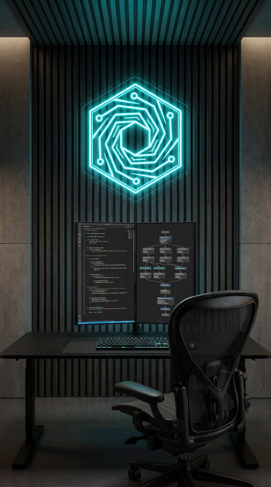

# LOCATION / SET PROMPT: Nova Labs AI & Software Engineering Lab

**Nombre del Set:** Nova Labs AI & Software Engineering Lab
**Ubicación:** `workspaces/novalabs/projects/0001-lanzamiento-engineering-innovation/sets/set_01_tech_lab.md`

## 🎬 Prompt de Generación (Image-to-Image / Style Reference)

Para generar el escenario vacío perfecto que servirá de fondo (Background Plate) en todas las tomas de este proyecto, utiliza el siguiente prompt hiper-realista.

**⚠️ INSTRUCCIÓN CRÍTICA (LOGO REF):**
Debes pasarle al motor de IA (Midjourney, Imagen 4, FLUX) el archivo de imagen `workspaces/novalabs/assets/brand/logo.png` como referencia de imagen (Image Prompt / `--cref` / Image Weight) para que integre la forma hexagonal y el vortex del logo en el neón de la pared de fondo.

**[ENGLISH PROMPT]**
Perfect front-facing, symmetrical wide camera angle. An empty, state-of-the-art modern software engineering and artificial intelligence laboratory. In the foreground, a sleek minimalist matte black ergonomic workstation desk (#0A0A0A) with a clean mechanical keyboard featuring subtle teal backlighting, and an empty modern ergonomic mesh office chair. Dual rimless vertical high-resolution monitors on the desk displaying crisp, elegant dark-mode Python code and node-based neural network architecture. The background is a sophisticated architectural wall of dark acoustic charcoal wood slats and matte polished concrete. Mounted on the central wall is a perfectly defined, undistorted, elegant glowing neon sign that perfectly mimics the hexagonal vortex shape of the provided reference logo, emitting a vibrant teal and cyan glow (#00BCD4 and #40E0FF). Every element from foreground to background is in perfectly sharp focus (deep depth of field, f/11 aperture, no blur, no bokeh). The lighting is cinematic chiaroscuro with deep clean shadows, subtle warm architectural ambient fill, and sharp teal edge lights. Ultra-realistic, cinematic High-End Commercial aesthetic, shot on ARRI Alexa 65, 8k resolution, photorealistic architecture. NO PEOPLE. EMPTY CHAIR. NO HUMANS.

## ⚙️ Parámetros Técnicos
- **Aspect Ratio:** `9:16` (Vertical TikTok / Reels)
- **Negative Prompt:** `People, humans, faces, characters, text, letters, typography, cartoon, anime, 3d render, messy cables, clutter, blur, bokeh, shallow depth of field, out of focus.`

## 🖼️ Muestra Generada (Background Plate)

