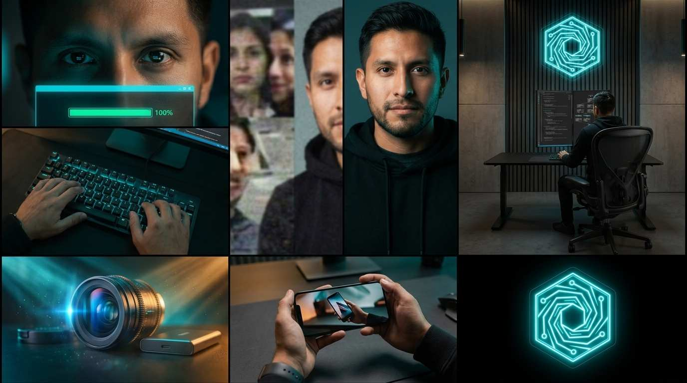
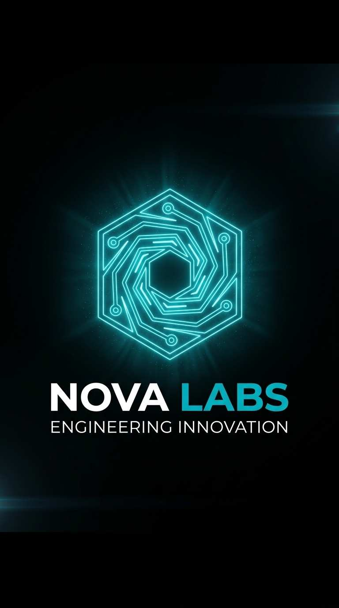

# STORYBOARD: Spot de Lanzamiento - Engineering Innovation (`0001-lanzamiento-engineering-innovation`)

**Workspace:** Nova Labs Bolivia (`novalabs`)  
**Reparto (Lore):** `lead-engineer` (Actor Propietario de Nova Labs)  
**Set Base:** `set_01_tech_lab.md` (Tech Lab con iluminación Chiaroscuro y Neón Teal)  
**Formato:** TikTok / Reels / Shorts (Vertical 9:16)  
**Duración Total:** 37 segundos (6 tomas continuas de máx. 7s cada una)  
**Audio Policy:** Audio limpio en clips (Zero música de fondo interna). Banda sonora única generada en `render/music.md`.

---

## 🎬 Desglose Cinematográfico por Tomas

### Toma 1 (Hook Disruptivo: Mirada en Penumbra)
- **Toma:** 1
- **Thumbnail (Visual):** Extreme Close-Up anamórfico a los ojos de `lead-engineer` en penumbra, reflejando el progreso del 100% de render en el monitor con una ráfaga de luz Teal (`#00BCD4`).
- **Acción/Narrativa:** El ingeniero observa fijamente el monitor vertical; la barra de render llega al 100% y una explosión de luz cian ilumina sus ojos mientras la cámara hace un micro-temblor de impacto.
- **Cámara y Fotografía:**
  - **Plano:** ECU (Extreme Close-Up) / Lente: 85mm Anamorphic T1.9
  - **Movimiento de cámara:** Smooth push-in sutil con micro-shake de impacto
  - **Iluminación:** Chiaroscuro dramático, penumbra profunda con luz emitida del monitor (`#00BCD4`)
  - **Color Grading:** Teal and Orange cinemático, negros densos y puros (`#0A0A0A`)
- **Duración:** 0:00 - 0:04 (4s)
- **Audio/Voz en Off:** *(SFX: Pulso de sub-bass profundo y tecleo mecánico que se corta en seco con un silencio abrupto)*. **VOZ EN OFF:** *"El noventa por ciento de los videos con Inteligencia Artificial se ven baratos..."*
- **Transición:** Whip-pan rápido vertical

---

### Toma 2A (El Contraste: Ingeniería vs Simple Prompt)
- **Toma:** 2A
- **Thumbnail (Visual):** Close-Up macro en ángulo de las manos de `lead-engineer` tecleando ágilmente en su teclado mecánico con retroiluminación cian (`#00BCD4`), mientras el borde inferior de los monitores verticales muestra código Python y grafos de redes neuronales compilándose.
- **Acción/Narrativa:** En lugar de un prompt de texto amateur de chatbot, vemos la ejecución rigurosa de código de ingeniería real: dedos precisos sobre teclas mecánicas, reflejos metálicos del smartwatch de titanio y la arquitectura visual del software.
- **Cámara y Fotografía:**
  - **Plano:** CU (Close-Up) Macro / Lente: 35mm Cine Lens f/1.8
  - **Movimiento de cámara:** Movimiento de slider lateral suave de izquierda a derecha con rack focus hacia los reflejos de las pantallas
  - **Iluminación:** Chiaroscuro de estación de trabajo con luz emitida cian-teal (`#00BCD4`) y sombras limpias (`#0A0A0A`)
  - **Color Grading:** Negros profundos, alto contraste y destellos anamórficos cian en las teclas
- **Duración:** 0:04 - 0:10 (6s)
- **Audio/Voz en Off:** *(SFX: Tecleo fluido y mecánico con eco de estudio, zumbido electrónico limpio)*. **VOZ EN OFF:** *"...porque cualquiera puede escribir un prompt. Pero casi nadie entiende de cinematografía e ingeniería."*
- **Transición:** Match Cut dinámico hacia el plano medio del laboratorio (Toma 2B)

---

### Toma 2B (Precisión Técnica: Laboratorio en Acción)
- **Toma:** 2B
- **Thumbnail (Visual):** Travelling dinámico sobre las manos de `lead-engineer` en el teclado mecánico retroiluminado en cian. Al fondo, la silla ergonómica y los monitores verticales con código Python y el logo de neón de Nova Labs (`set_01_tech_lab.md`).
- **Acción/Narrativa:** `lead-engineer` teclea con fluidez supervisando un pipeline de agentes; al fondo se observa el laboratorio minimalista de software con los monitores duales y el logo hexagonal de neón de Nova Labs en la pared de lamas de madera.
- **Cámara y Fotografía:**
  - **Plano:** Over-The-Shoulder (OTS) a Medium Shot / Lente: 50mm Prime f/1.8
  - **Movimiento de cámara:** Travelling lateral suave (Dolly right) revelando la profundidad del set
  - **Iluminación:** Luz volumétrica cálida ambiental con acentos lineales cian (`#00BCD4`) y luz de neón de fondo (`#40E0FF`)
  - **Color Grading:** Contraste arquitectónico sofisticado, sombras limpias y grano sutil de 35mm
- **Duración:** 0:10 - 0:17 (7s)
- **Audio/Voz en Off:** *(SFX: Beat rítmico híbrido cinematográfico acelerando progresivamente, pulsaciones mecánicas)*. **VOZ EN OFF:** *"En Nova Labs no dejamos nada al azar. Fusionamos arquitectura de software, neuromarketing y dirección de arte real en cada segundo."*
- **Transición:** Match Cut cinemático de movimiento

---

### Toma 3A (Cinematografía & Retención: Macro y Anamórfico)
- **Toma:** 3A
- **Thumbnail (Visual):** B-Roll de cámara lenta a 120fps de un lente anamórfico girando con flares cian horizontales, y un plano macro de un producto tecnológico bañado en luz Teal y ámbar cálido.
- **Acción/Narrativa:** Demostración de virtuosismo cinematográfico: un lente de cine enfoca rápidamente hacia un producto publicitario en rotación suave, mostrando texturas hiperdetalladas y destellos de luz.
- **Cámara y Fotografía:**
  - **Plano:** CU (Close-Up) y Macro Shot / Lente: 100mm Macro Cine Lens T2.8
  - **Movimiento de cámara:** Órbita rápida de 180° que desacelera en cámara lenta extrema (120fps)
  - **Iluminación:** Luz de recorte lateral Teal (`#00BCD4`), key light dorada cálida y haz volumétrico
  - **Color Grading:** Look comercial de alta gama (Spec Ad), saturación selectiva en cian y ámbar
- **Duración:** 0:17 - 0:24 (7s)
- **Audio/Voz en Off:** *(SFX: Whoosh cinematográfico, crescendo de cuerdas y sintetizadores analógicos envolventes)*. **VOZ EN OFF:** *"Creamos contenido que no solo detiene el scroll... sino que posiciona a tu negocio como una marca de primer nivel."*
- **Transición:** Fast Cut sincopado con percusión

---

### Toma 3B (Ecosistema & Autoridad PyME: Resultados en Móvil)
- **Toma:** 3B
- **Thumbnail (Visual):** Match-cuts dinámicos de smartphones de alta gama sostenidos en mano mostrando videos comerciales de Nova Box y catálogos web interactivos consumidos en redes sociales.
- **Acción/Narrativa:** Muestra tangible de los resultados comerciales en el mundo real: videos de producto fluidos y modernos desplegándose en pantallas OLED de teléfonos móviles sobre superficies de madera y concreto pulido.
- **Cámara y Fotografía:**
  - **Plano:** POV / Medium Close-Up (MCU) / Lente: 35mm f/1.4
  - **Movimiento de cámara:** Micro-movimientos de cámara en mano orgánica (subtle handheld)
  - **Iluminación:** Luz suave difusa de estudio con reflejos nítidos en los bordes de los teléfonos
  - **Color Grading:** Tonos naturales premium, excelente contraste y negros profundos OLED
- **Duración:** 0:24 - 0:31 (7s)
- **Audio/Voz en Off:** *(SFX: Percusión electrónica épica y contundente al compás de los cortes visuales)*. **VOZ EN OFF:** *"Probado en el mercado real. Desarrollado por ingenieros de sistemas para empresas que juegan en serio."*
- **Transición:** Hard Cut a negro con caída abrupta del audio

---

### Toma 4 (Clímax, Logo Reveal & CTA: Identidad de Marca)
- **Toma:** 4
- **Thumbnail (Visual):** Fondo negro puro (`#0A0A0A`) donde se enciende el isotipo hexagonal con vortex de Nova Labs en Teal brillante (`#00BCD4`), seguido de la tipografía `NOVA LABS` y `ENGINEERING INNOVATION`.
- **Acción/Narrativa:** La música cae en silencio absoluto (drop emocional). En la oscuridad absoluta, un destello holográfico despierta el logo de Nova Labs que pulsa con energía cian y genera un resplandor elegante. Aparece el CTA hacia WhatsApp/perfil.
- **Cámara y Fotografía:**
  - **Plano:** Wide Frontal Centrado / Lente: 50mm Prime f/2.0
  - **Movimiento de cámara:** Push-in extremadamente suave y majestuoso
  - **Iluminación:** Darkness total con luz emitida propia (Self-Illuminated Neon Glow `#40E0FF` y `#00BCD4`)
  - **Color Grading:** Negro espacial absoluto (`#0A0A0A`) y Teal cian eléctrico saturado
- **Duración:** 0:31 - 0:37 (6s)
- **Audio/Voz en Off:** *(SFX: Drop masivo de bajo subsónico y zumbido holográfico cristalino en silencio absoluto)*. **VOZ EN OFF:** *"Nova Labs Bolivia. Engineering Innovation."* *(Pausa de 1 segundo)* *"Escríbenos al enlace del perfil y eleva tu marca hoy."*
- **Transición:** Fade Out a negro

---

## 🎨 Bloque 1: Prompt Visual Global del Storyboard (Tomas 1 a 4)

*LORE GLOSSARY:*  
*[lead-engineer] = A sharp-featured 30-year-old Bolivian Latino male systems engineer with short styled dark hair, a clean trimmed stubble beard, dark brown eyes, wearing a premium minimalist matte black cotton hoodie, dark charcoal grey crewneck t-shirt, and slim-fit black tactical cargo pants.*

*PROMPT:*  
*Ultra-realistic, cinematic High-End Commercial style, ARRI Alexa 35mm look, chiaroscuro dramatic lighting, Teal (#00BCD4) and warm amber grading, subtle film grain, 8k photorealistic. A 6-panel comic-style storyboard layout (2 rows of 3 panels) displaying the cinematic progression of a tech commercial:*  
*- Panel 1: Extreme Close-Up of [lead-engineer]'s eyes in a dark modern office, illuminated by a glowing cyan teal computer screen reflection showing a 100% completion bar. Dramatic low key chiaroscuro lighting.*  
*- Panel 2: Split screen comparison shot. Left side shows a poorly generated, blurry amateur AI video with washed-out colors and distorted faces. Right side shows a hyper-detailed cinematic portrait with sharp 35mm textures and perfect lighting.*  
*- Panel 3: Medium shot in an architectural tech lab with dark acoustic wood slats and concrete walls. [lead-engineer] typing at a sleek matte black desk with a glowing teal mechanical keyboard and dual vertical monitors displaying clean code. An illuminated hexagonal vortex logo glows on the background wall.*  
*- Panel 4: Close-Up macro shot of a cinematic camera lens with cyan anamorphic flares, next to a sleek tech product bathed in volumetric teal and amber lights with suspended dust particles.*  
*- Panel 5: First-person POV medium close-up of hands holding a premium smartphone displaying a high-definition commercial video with smooth graphics and vibrant colors, on an architectural office desk.*  
*- Panel 6: Symmetrical front shot on a deep pure black background (#0A0A0A). An elegant glowing neon sign in vibrant teal (#00BCD4) and cyan glow (#40E0FF) in the shape of a hexagonal vortex, with volumetric light aura.*  
*CRITICAL: Do not include any text, letters, subtitles, words, or speech bubbles anywhere in the image. The image must be completely free of typography.*

---

## 🖼️ Visualización del Storyboard

### 💎 Keyframe de Cierre: Motion Logo Reveal Oficial

