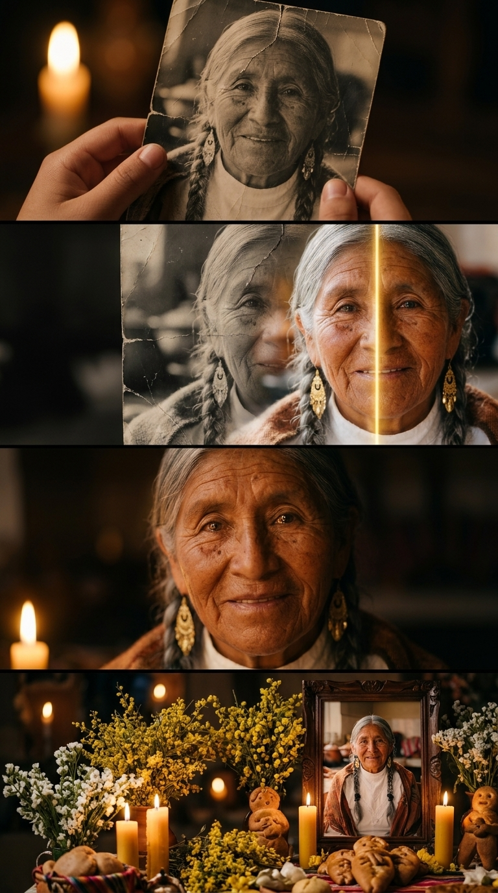

# STORYBOARD CINEMATOGRÁFICO: TODOS SANTOS RECUERDO VIVO
**Proyecto:** Todos Santos: Recuerdo Vivo (`0002-todos-los-santos-recuerdo-vivo`)  
**Workspace:** Nova Labs Bolivia (`novalabs`)  
**Reparto / Personajes:** Retrato tradicional boliviano (`abuela-recuerdo`)  
**Set Base:** Mesa y Altar Tradicional de Todos Santos (`sets/set_01_altar_todos_santos.md`)  
**Duración Total:** 24 segundos (4 tomas de 4s a 7s cada una)  
**Formato de Pantalla:** Vertical 9:16 (Optimizado para TikTok, Reels, Shorts y WhatsApp Status)  
**Estilo Visual Base:** Cinematic emotional realism, ARRI Alexa 35mm aesthetic, warm candlelight chiaroscuro, golden amber (`#FFA726`) and deep velvety charcoal grading, authentic Bolivian cultural warmth, vintage photography texture transitioning into ultra-detailed 8K photographic fidelity, intimate shallow depth of field (f/1.8).  

---

## 🎬 DESGLOSE TÉCNICO ESCENA POR ESCENA

### Toma 1 (Hook Viral Disruptivo: La Fotografía Desgastada)
- **Toma:** 1
- **Thumbnail (Visual):** Primer plano macro a manos sosteniendo una fotografía antigua boliviana en blanco y negro, doblada y con una grieta áspera en el rostro.
- **Acción/Narrativa:** El video abre de golpe en la intimidad familiar. Un joven sostiene la foto rota de su abuelita; al fondo titila una vela en penumbra.
- **Cámara y Fotografía:**
  - **Plano:** Extreme Close-Up (ECU) macro anamórfico a 45 grados / Lente 85mm Macro, f/2.0.
  - **Movimiento de cámara:** Zoom dinámico suave hacia la foto (*Dynamic Push-In*).
  - **Iluminación:** Penumbra íntima iluminada por la flama cálida de una vela de cera virgen al fondo.
  - **Color Grading:** Sepia y blanco y negro envejecido con grano analógico deslavado en la foto; fondo en ámbar cálido.
- **Duración:** 4s (0:00 - 0:04)
- **Audio/Voz en Off:** *"¿Y si pudieras volver a ver la sonrisa de tus abuelitos?"*
- **Transición:** Match Cut continuo a la misma foto para iniciar la restauración.

---

### Toma 2 (La Transformación "Satisfying": Restauración 8K)
- **Toma:** 2
- **Thumbnail (Visual):** Una línea vertical de luz dorada recorre la foto como un escáner mágico, sellando las grietas y revelando color 8K hiperrealista.
- **Acción/Narrativa:** Efecto visual "satisfying" de Antes / Después. El papel maltratado desaparece y florece la textura de la piel trigueña andina, su blusa de encaje blanco y los aretes dorados.
- **Cámara y Fotografía:**
  - **Plano:** Close-Up (CU) macro continuo / Lente 85mm, f/2.0.
  - **Movimiento de cámara:** Cámara lenta flotante con micro-tracking horizontal al barrido de luz.
  - **Iluminación:** Chiaroscuro cálido con destellos dorados que emanan de la línea de escaneo lumínico.
  - **Color Grading:** Transición dividida de escala de grises fría a tonos tierra cálidos, piel andina luminosa y dorado vivo.
- **Duración:** 6s (0:04 - 0:10)
- **Audio/Voz en Off:** *"En Nova Labs restauramos tus fotografías familiares más dañadas y les devolvemos la vida."*
- **Transición:** Match Cut sutil hacia el rostro restaurado.

---

### Toma 3 (El Clímax Emocional: Recuerdo Vivo)
- **Toma:** 3
- **Thumbnail (Visual):** La abuelita parpadea suavemente, sus pupilas reflejan las velas, asiente con dulzura y sonríe mirando a los ojos del espectador (sin hablar).
- **Acción/Narrativa:** Milagro del reencuentro de almas. El retrato cobra movimiento orgánico a 24fps. Cero movimiento de boca para garantizar 100% hiperrealismo sin artefactos de lip-sync.
- **Cámara y Fotografía:**
  - **Plano:** Medium Close-Up (MCU) / Lente 50mm, f/1.8.
  - **Movimiento de cámara:** Fijo con respiración sutil de cámara en mano (*Subtle Handheld Breathing*).
  - **Iluminación:** Luz cálida frontal difusa de velas, reflejo de flama en las pupilas, halo dorado suave en el contorno del cabello plateado.
  - **Color Grading:** Piel cálida aterciopelada, tonos ámbar dorados (`#FFA726`) y sombras carbón profundas (`#0A0A0A`).
- **Duración:** 7s (0:10 - 0:17)
- **Audio/Voz en Off:** *"Para que hoy y siempre... su recuerdo vuelva a iluminar tu mesa."*
- **Transición:** Paneo suave en retroceso hacia la mesa de Todos Santos.

---

### Toma 4 (El Altar de Todos Santos & Llamado a la Acción)
- **Toma:** 4
- **Thumbnail (Visual):** La foto restaurada reposa enmarcada en fino cedro oscuro presidiendo la mesa tradicional de Todos Santos con velas, retama, flores de ilusión y tanta wawas.
- **Acción/Narrativa:** Resolución cultural y homenaje solemne. La familia contempla la mesa lista para recibir el alma de la abuelita. Placa limpia de Nova Labs y datos de WhatsApp.
- **Cámara y Fotografía:**
  - **Plano:** Plano Medio General (Medium Wide Shot) / Lente 35mm anamórfico, f/2.8.
  - **Movimiento de cámara:** Travelling suave en retroceso (*Slow Dolly Out*).
  - **Iluminación:** Altar completo iluminado por el resplandor cálido de múltiples velas de cera virgen.
  - **Color Grading:** Ámbar dorado ceremonial, contraste con el mantel oscuro y el amarillo brillante de la retama.
- **Duración:** 7s (0:17 - 0:24)
- **Audio/Voz en Off:** *"Prepara tu mesa con el homenaje que ellos merecen. Escríbenos al WhatsApp y vuelve a ver su sonrisa."*
- **Transición:** Fade to black suave con isotipo de Nova Labs Bolivia.

---

## 🖼️ BLOQUE 1: PROMPT GLOBAL Y SECUENCIA GRÁFICA (TOMAS 1 A 4)

*LORE GLOSSARY:*  
*[abuela-recuerdo] = A beloved 72-year-old Bolivian indigenous-mestiza grandmother with warm copper skin, dignified smile wrinkles, silver-gray hair in two traditional braids, wearing a crisp white vintage lace blouse, terracotta woven wool shawl with fringes, and antique Bolivian gold filigree drop earrings.*  

*PROMPT:*  
*A 4-panel cinematic storyboard layout (arranged in a 2x2 grid) in vertical 9:16 aspect ratio. Cinematic emotional realism, ARRI Alexa 35mm aesthetic, warm candlelight chiaroscuro, golden amber (#FFA726) and deep velvety charcoal grading, authentic Bolivian Todos Santos cultural warmth, intimate shallow depth of field.*  
*- Panel 1 (Top Left): Extreme close-up of young hands holding an old, cracked, vintage black-and-white 1950s family photograph of [abuela-recuerdo]. The paper photo is heavily aged, with worn creased corners, surface scratches, and a prominent crack across the forehead. Warm candle flame glowing softly in the blurred background.*  
*- Panel 2 (Top Right): Close-up of the photograph being restored. A sharp glowing golden vertical line of light sweeps across the photo like a magic scanner: the left side of the photo is damaged vintage monochrome, while the right side is blooming into rich, vibrant, ultra-detailed 8K color showing [abuela-recuerdo]'s warm skin and golden earrings.*  
*- Panel 3 (Bottom Left): Medium close-up of the restored portrait coming alive. [abuela-recuerdo] looks directly at the viewer with warm, lifelike eyes capturing candle reflections, head gently tilted, and a serene, deeply loving closed-mouth smile of recognition and peace. Intimate warm candlelight chiaroscuro lighting.*  
*- Panel 4 (Bottom Right): Medium wide shot of a traditional Bolivian Todos Santos memorial altar table (Mesa de Todos Santos). The restored color portrait of [abuela-recuerdo] is displayed in an elegant dark carved cedar wood frame at the center, surrounded by glowing beeswax candles, yellow retama flowers, delicate white ilusión flowers, and traditional artisanal baked tanta wawas bread figures in soft background bokeh.*  
*CRITICAL: Do not include any text, letters, subtitles, words, or speech bubbles anywhere in the image. The image must be completely free of typography.*  

