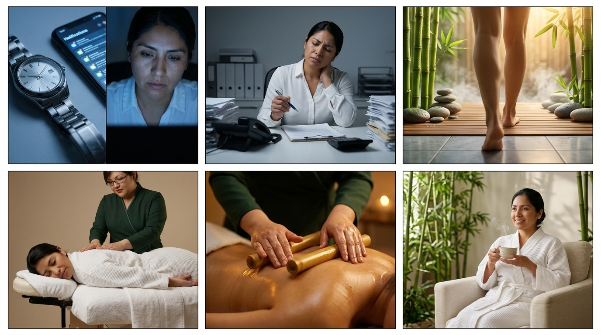
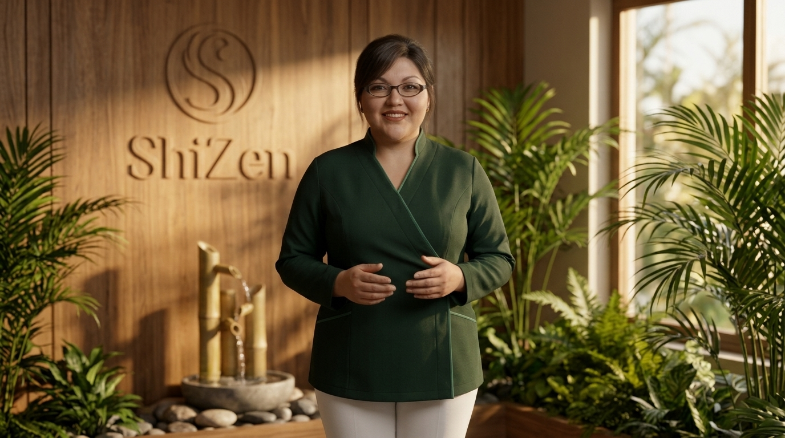

# STORYBOARD CINEMATOGRÁFICO: La Hora Invisible
**Proyecto:** Gabinete ShiZen - La Hora Invisible (0001)  
**Workspace:** Gabinete ShiZen  
**Reparto (Lore):** Alejandra (especialista y fundadora de ShiZen, 36 años), Camila (mujer profesional, 34 años)  
**Duración Total:** 45 segundos  
**Aspect Ratio:** 9:16 (Vertical Cinematic)  
**Estilo Visual Global:** Ultra-realistic, cinematic High-End Commercial style, zen luxury wellness aesthetic, warm natural daylight with subtle chiaroscuro shadows, authentic bamboo and green foliage, clean teak wood textures, photorealistic skin and hands, ARRI Alexa 65, 8k resolution.  

---

## 🎨 BLOQUE 1: PANELES 1 AL 6 (EL AGOTAMIENTO Y LA INMERSIÓN EN EL JARDÍN)

*LORE GLOSSARY:*  
*[alejandra] = 36-year-old Bolivian master wellness therapist and cosmetologist Alejandra, authentic round friendly face, thin dark oval eyeglasses, neat side-swept bangs in low chignon, full-figured curvy robust plus-size build, wearing tailored dark forest green crossover wrap spa tunic with jade green piping, white tailored spa trousers, white clinic shoes, caring hands.*  
*[camila] = 34-year-old Bolivian professional woman Camila, expressive face, dark brown hair, wearing business casual attire in office scenes and white luxury waffle spa robe/white linen in ShiZen wellness scenes.*  

*PROMPT:*  
*A 6-panel comic-style storyboard layout (2 rows of 3 panels) displaying sequential movie frames with clear visual storytelling. Ultra-realistic, cinematic High-End Commercial style, zen luxury wellness aesthetic, warm natural daylight with subtle chiaroscuro shadows, authentic bamboo and green foliage, clean teak wood textures, photorealistic skin and hands, ARRI Alexa 65, 8k resolution. Panel 1 (Top-Left): INT. MODERN OFFICE IN COCHABAMBA. Macro close-up shot focusing on a ticking wristwatch and smartphone glowing with notifications, rack-focus onto [camila]'s fatigued face illuminated by cold 6500K blue monitor light. Panel 2 (Top-Middle): INT. MODERN OFFICE IN COCHABAMBA. Medium close-up of [camila] sitting at a cluttered desk, dropping a pen and clutching her stiff aching neck in exhaustion, cold desaturated lighting. Panel 3 (Top-Right): INT. GABINETE SHIZEN WELLNESS SPA. Chromatic shift to warm golden 3200K daylight. POV walking past fresh green bamboo stalks with morning dew, river stones, rising steam, walking barefoot onto warm teak wood decking. Panel 4 (Bottom-Left): INT. GABINETE SHIZEN MASSAGE ROOM. [camila] lying prone on a wooden massage table covered in white towels. [alejandra] gently resting her warm palms on Camila's upper back, causing Camila to release a deep relaxing breath as shoulders drop in relief. Panel 5 (Bottom-Middle): INT. GABINETE SHIZEN MASSAGE ROOM. Sensorial macro close-up of [alejandra]'s skilled hands massaging warm botanical oil onto relaxed skin, and sliding warm polished bamboo stalks along back muscles, golden amber spa lighting. Panel 6 (Bottom-Right): INT. GABINETE SHIZEN RELAXATION AREA. Medium shot of [camila] sitting peacefully in a cream linen armchair beside an indoor bamboo garden, looking radiant and revitalized, holding a steaming cup of herbal tea with a serene smile. CRITICAL: Do not include any text, letters, subtitles, words, or speech bubbles anywhere in the image. The image must be completely free of typography.*  

---

### Toma 1 (Hook Dinámico & Cromático)
- **Toma:** 1
- **Thumbnail (Visual):** Macro rack-focus de segundero metálico a pantalla de smartphone con notificaciones vibrantes, revelando el rostro agotado de Camila bañado en luz azul fría de monitor.
- **Acción/Narrativa:** El tic-tac incesante y el destello de notificaciones atrapan el scroll de inmediato. Camila exhala cansancio mientras las exigencias del día se acumulan.
- **Cámara y Fotografía:**
  - **Plano:** ECU (Extreme Close Up) a MCU (Medium Close Up) / Lente 100mm Macro f/2.8
  - **Movimiento de cámara:** Rack-focus rápido con sutil crash-zoom hacia el rostro
  - **Iluminación:** Luz fría artificial de pantalla (6500K), sombras duras de oficina
  - **Color Grading:** Tonos acerados, cian frío, atmósfera estéril y sobrecargada
- **Duración:** 0:00 - 0:03 (3s)
- **Audio/Voz en Off:** "(SFX: Zumbido saturado de notificaciones y tic-tac acelerado) / Voz en off femenina íntima: '¿Cuándo fue la última vez que exististe solo para ti...?'"
- **Transición:** Hard Cut rítmico

---

### Toma 2 (El Agotamiento Somático)
- **Toma:** 2
- **Thumbnail (Visual):** Camila sentada ante un escritorio repleto de papeles, soltando el bolígrafo y llevándose la mano al cuello con gesto de dolor cervical mientras el reloj de pared marca las 3:42 PM.
- **Acción/Narrativa:** Visibiliza el precio físico del estrés diario: rigidez muscular, contractura en trapecios y sobrecarga mental.
- **Cámara y Fotografía:**
  - **Plano:** MCU (Medium Close Up) / Lente 50mm Cine Prime f/1.8
  - **Movimiento de cámara:** Lento dolly-in hacia la nuca y hombros de Camila
  - **Iluminación:** Tubos fluorescentes cenitales difusos y luz lateral de ventana grisácea
  - **Color Grading:** Desaturado, contrastes opacos que acentúan la pesadez física
- **Duración:** 0:03 - 0:09 (6s)
- **Audio/Voz en Off:** "(SFX: Ruido lejano de tráfico de ciudad y tecleo) / Voz en off: '...sin tener que ser la jefa, la mamá o la responsable de todo?'"
- **Transición:** Match Cut cromático radical (de 6500K frío a 3200K dorado)

---

### Toma 3 (El Umbral Térmico del Jardín)
- **Toma:** 3
- **Thumbnail (Visual):** POV en cámara lenta rozando cañas de bambú verdes con rocío cristalino, vapor herbal ascendente y pies descalzos pisando madera tibia de teca junto a piedras de río pulidas.
- **Acción/Narrativa:** Ruptura sensorial total. El espectador y Camila cruzan el umbral hacia el jardín interior zen de ShiZen en Cochabamba; el estrés exterior se desvanece al instante.
- **Cámara y Fotografía:**
  - **Plano:** POV (Point of View) dinámico / Lente 24mm Wide Angle f/2.0
  - **Movimiento de cámara:** Forward tracking suave a 60fps slow-motion
  - **Iluminación:** Luz dorada cálida natural filtrada (3200K), halo de vapor y contraluz suave
  - **Color Grading:** Verde bosque profundo (#234D3E), jade translúcido (#48B69A) y tonos ámbar miel
- **Duración:** 0:09 - 0:15 (6s)
- **Audio/Voz en Off:** "(Corte abrupto de ruido urbano -> Murmullo cristalino de agua fluyendo sobre bambú y pasos en madera) / Voz en off: 'Existe un lugar en Cochabamba donde el reloj se detiene...'"
- **Transición:** Soft Dissolve sensorial

---

### Toma 4 (El Silencio de Caída y la Exhalación)
- **Toma:** 4
- **Thumbnail (Visual):** Camila recostada boca abajo en camilla de madera envuelta en bata waffle blanca. Alejandra apoya sus dos palmas cálidas sobre su espalda alta; los hombros de Camila descienden visiblemente en alivio.
- **Acción/Narrativa:** Neuronas espejo y reseteo dopaminérgico. El contacto humano cálido genera un momento de suspensión total seguido de un suspiro de liberación somática.
- **Cámara y Fotografía:**
  - **Plano:** MS (Medium Shot) cenital-lateral / Lente 35mm f/1.4
  - **Movimiento de cámara:** Estático / Micro-flotación orgánica
  - **Iluminación:** Soft key light ámbar difusa a 45 grados, penumbra relajante
  - **Color Grading:** Tonos crema, madera de roble, piel natural con micro-textura hiperrealista
- **Duración:** 0:15 - 0:22 (7s)
- **Audio/Voz en Off:** "[0:15-0:16: SILENCIO TOTAL DE 0.8s] -> Suspiro profundo y tembloroso de Camila, entra nota de piano y cuenco tibetano: '...donde nadie te pide nada.'"
- **Transición:** Cut on action

---

### Toma 5 (La Maestría de Te no Waza & Bambú Tibio)
- **Toma:** 5
- **Thumbnail (Visual):** Macro cinematográfico de gota de aceite botánico tibia escurriendo sobre la piel, manos expertas de Alejandra aplicando técnica manual descontracturante y deslizando cañas de bambú pulidas tibias.
- **Acción/Narrativa:** Demostración de autor de *Te no Waza* y bambuterapia. Se enfatiza la destreza artesanal, el cuidado personalizado y el alivio de contracturas profundas.
- **Cámara y Fotografía:**
  - **Plano:** Macro ECU (Extreme Close Up) / Lente 90mm Macro f/2.8 a 60fps
  - **Movimiento de cámara:** Glide lateral ultra-fluido siguiendo el curso del bambú
  - **Iluminación:** Luz lateral rasante que destaca el brillo del aceite y la textura del bambú
  - **Color Grading:** Dorado miel enriquecido, sombras suaves cálidas, piel luminosa
- **Duración:** 0:22 - 0:29 (7s)
- **Audio/Voz en Off:** "(SFX Foley ASMR: Fricción sedosa de aceite sobre piel y crujido cálido del bambú) / Voz en off: 'El arte de sanar con las manos.'"
- **Transición:** Smooth Whip Pan

---

### Toma 6 (El Renacer y la Paz)
- **Toma:** 6
- **Thumbnail (Visual):** Camila sentada plácidamente en sillón de lino crema junto al jardín de bambú interior, rostro descansado, sosteniendo con ambas manos una taza de té humeante con una sonrisa serena.
- **Acción/Narrativa:** Cierre del arco de transformación: la mujer estresada del inicio ahora irradia paz mental, vitalidad y desconexión plena.
- **Cámara y Fotografía:**
  - **Plano:** MS (Medium Shot) / Lente 50mm Cine f/1.4
  - **Movimiento de cámara:** Lento dolly-out revelando el entorno de jardín
  - **Iluminación:** Luz natural difusa de tragaluz cenital, partículas de vapor flotando
  - **Color Grading:** Paleta balanceada, blancos crema puros, verdes esmeralda vivos
- **Duración:** 0:29 - 0:37 (8s)
- **Audio/Voz en Off:** "(Música de piano y cuerdas en crescendo emotivo cálido) / Voz en off: 'No es un lujo. Es el recordatorio de que tu cuerpo merece ser cuidado con la misma entrega con la que tú cuidas a los demás.'"
- **Transición:** Dissolve elegante

---

## 🎨 BLOQUE 2: PANEL 7 (PRESENTACIÓN DE AUTOR Y LLAMADO A LA ACCIÓN)

*LORE GLOSSARY:*  
*[alejandra] = 36-year-old Bolivian master wellness therapist and cosmetologist Alejandra, authentic round friendly face, thin dark oval eyeglasses, neat side-swept bangs in low chignon, full-figured curvy robust plus-size build, wearing tailored dark forest green crossover wrap spa tunic with jade green piping, white tailored spa trousers, white clinic shoes, caring hands.*  

*PROMPT:*  
*A single-panel widescreen cinematic storyboard movie frame. Ultra-realistic, cinematic High-End Commercial style, zen luxury wellness aesthetic, warm natural daylight with subtle chiaroscuro shadows, authentic bamboo and green foliage, clean teak wood textures, photorealistic skin and hands, ARRI Alexa 65, 8k resolution. LORE GLOSSARY: [alejandra] = 36-year-old Bolivian master wellness therapist and cosmetologist Alejandra, authentic round friendly face, thin dark oval eyeglasses, neat side-swept bangs in low chignon, full-figured curvy robust plus-size build, wearing tailored dark forest green crossover wrap spa tunic with jade green piping, white tailored spa trousers, white clinic shoes, caring hands. Scene Description: INT. GABINETE SHIZEN - ZEN RECEPTION IN COCHABAMBA. Medium shot (MS) of [alejandra] standing poised in the reception area. Behind her is a luxury natural wood accent wall with the elegant embossed ShiZen logo, soft bokeh lighting, and a gentle bamboo water fountain trickling over river stones with lush tropical indoor greenery. Alejandra looks directly into the camera with an authentic, warm, reassuring and compassionate smile, speaking with welcoming poise. CRITICAL: Do not include any text, letters, subtitles, words, or speech bubbles anywhere in the image. The image must be completely free of typography.*  

---

### Toma 7 (Alejandra / Presentación y Llamado a la Acción)
- **Toma:** 7
- **Thumbnail (Visual):** Alejandra en plano medio en la recepción zen de ShiZen, frente al logotipo tallado en madera noble y la fuente de agua de bambú, sonriendo con calidez y autoridad maternal hacia la cámara.
- **Acción/Narrativa:** Presentación personal de la fundadora. Ancla la confianza de autor: no es un centro masivo ni anónimo, es Alejandra cuidando personalmente de cada paciente. Cierre con invitación afectuosa.
- **Cámara y Fotografía:**
  - **Plano:** MS (Medium Shot) / Lente 85mm Portrait Cine Prime f/2.0 (suave bokeh de fondo)
  - **Movimiento de cámara:** Fijo con micro-estabilización cinematográfica
  - **Iluminación:** Key light difusa cálida envolvente (3200K) con rim light dorado en el cabello
  - **Color Grading:** Verde bosque profundo (#234D3E), madera cálida y tonos piel saludables
- **Duración:** 0:37 - 0:45 (8s)
- **Audio/Voz en Off:** "Alejandra a cámara (voz dulce, segura y cercana, modelo Enceladus): 'Tu momento, tus necesidades, mis manos y la naturaleza. Soy Alejandra, y te espero en Gabinete ShiZen para regalarte la hora que le debes a tu cuerpo.'"
- **Transición:** Fade to black suave con cierre de logo y contacto de WhatsApp (+591 75935959)
