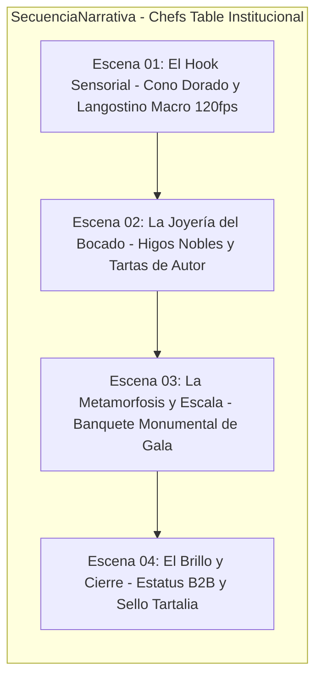

# 🎬 CONTEXTO DEL PROYECTO: Chef's Table Institucional (0001)

Este archivo define la dirección de arte, estándares cinematográficos y reglas narrativas específicas para el proyecto demo **`0001-chefs-table-institucional`** en el workspace **`tartalia`**.

---

## 1. 📋 METADATA DEL PROYECTO
- **ID:** `0001-chefs-table-institucional`
- **Nombre:** Chef's Table Institucional: La Joyería del Bocado B2B
- **Tipo de video:** Spec Ad Cinematográfico / Commercial Showcase
- **Duración objetivo:** 32–36 segundos (Dividido en 4 escenas de 8–9 segundos optimizadas para Google Flow VEO 3.1)
- **Formato:** Master 16:9 cinematográfico (con encuadre seguro para 9:16 en Reels/TikTok)
- **Plataformas de destino:** Proyección ejecutiva en reuniones con clientes, LinkedIn corporativo, Instagram Reels y campañas directas de captación.

---

## 2. 🎯 VISIÓN CREATIVA Y DOBLE OBJETIVO
El objetivo de este video es provocar un impacto estético tan descomunal que logre dos conversiones simultáneas:
1. **Impacto Tartalia:** Demostrar a Tartalia que su propuesta gastronómica puede lucir como una serie de alta cocina de Netflix (*Chef’s Table*), elevando el valor percibido de sus servicios a niveles de lujo internacional.
2. **Impacto Clientes Corporativos (Captación para Nova Labs):** Que los comités directivos de bancos (BISA, BancoSol), farmacéuticas (INTI) y organismos internacionales (ONU, OPS/OMS) al ver la pieza queden hipnotizados por la factura técnica y quieran contratar a **Nova Labs** para sus comerciales corporativos.

---

## 3. 🚫 REGLAS NARRATIVAS Y DE RODAJE OBLIGATORIAS
- **Cero Lip-Sync (Sin personajes hablando en cámara):** Queda **terminantemente prohibido** poner a personas hablando a cámara o moviendo los labios. Los personajes en pantalla (saloneros y ejecutivos corporativos) realizan acciones orgánicas elegantes y silenciosas: sostener bandejas con guantes, brindar en plano medio desenfocado, dar toques finales con pinzas culinarias o caminar con prestancia. Cero diálogo diegético.
- **Voz en Off (Voiceover) de Autor:** Toda la locución se narra en off por una voz ejecutiva, envolvente, cálida y de alta distinción en español neutro / paceño educado.
- **Diseño Sonoro Foley ASMR:** Cada plano macro visual debe tener su gemelo sonoro (el *crunch* de la masa hojaldrada, el murmullo de cristal de copas finas, el siseo sutil de sellado, el silencio protocolar).
- **Insumos de Escena Reales:** Cada escena debe anclarse directamente en los elementos fotográficos reales de Tartalia almacenados en `assets/references/` (las torres de conos dorados, los canapés de higos nobles con mousse, los bocaditos con flores comestibles y el montaje monumental frente a cristaleras corporativas).

---

## 4. 📐 ESTRUCTURA DE LAS 4 ESCENAS (8-9 SEGUNDOS C/U)

1. **Escena 01 (0–9s): El Hook Sensorial (Macro Cono Dorado)**
   - *Visual:* Plano macro extremo (100mm f/2.8 a 120fps). Fondo negro obsidiana. Mano con guante negro sosteniendo el cono dorado insignia de Tartalia. Langostino crujiente sumergiéndose suavemente en emulsión de maracuyá mientras caen micro-brotes verdes.
   - *Audio:* Foley crujiente nítido + inicio de cuerda neoclásica profunda. Voz en off: *"En los eventos que definen el rumbo de una institución... nada puede quedar al azar."*
2. **Escena 02 (9–18s): La Joyería del Bocado (Artesanía Culinaria)**
   - *Visual:* Rack focus lento sobre barquetas de higo fresco cortado en láminas perfectas, mousse de queso y flores comestibles moradas. Movimiento de cámara suave (*slider in*).
   - *Audio:* Voz en off: *"Cada bocado es una pieza de diseño efímero, pensada para disfrutarse con una sola mano y recordarse para siempre."*
3. **Escena 03 (18–27s): La Metamorfosis & Escala Monumental**
   - *Visual:* Del detalle microscópico, un paneo ascendente revela la escala completa: la torre de conos de acrílico de 5 pisos en medio de un banquete imperial frente a ventanales con vistas a La Paz y ejecutivos de gala brindando en plano desenfocado.
   - *Audio:* Clímax orquestal elegante. Voz en off: *"La solvencia de un servicio protocolar que respalda a la banca y a los organismos más exigentes del país."*
4. **Escena 04 (27–36s): El Cierre de Autoridad y Sello de Lujo**
   - *Visual:* Paneo lateral sobre copas de cristal de gala y mesa servida impecable. Animación tipográfica en *Cinzel* dorado fundiéndose con el logotipo clásico barroco de Tartalia: *"Lo bello puede ser exquisito."*
   - *Audio:* Nota de piano sostenida y copa que tintinea. Voz en off: *"Tartalia. Alta cocina y catering de autor. Eleva tu próximo evento."*

---

## 5. 📂 ASSETS DISPONIBLES EN EL PROYECTO
- [`mesa_conos_buffet.jpg`](file:///opt/publicidad/media-architect/workspaces/tartalia/projects/0001-chefs-table-institucional/assets/references/mesa_conos_buffet.jpg)
- [`detalle_conos_flores_pasteleria.jpg`](file:///opt/publicidad/media-architect/workspaces/tartalia/projects/0001-chefs-table-institucional/assets/references/detalle_conos_flores_pasteleria.jpg)
- [`montaje_monumental_edificio_cristal.jpg`](file:///opt/publicidad/media-architect/workspaces/tartalia/projects/0001-chefs-table-institucional/assets/references/montaje_monumental_edificio_cristal.jpg)
- [`canapes_higos_gourmet.jpg`](file:///opt/publicidad/media-architect/workspaces/tartalia/projects/0001-chefs-table-institucional/assets/references/canapes_higos_gourmet.jpg)
- [`desayuno_ejecutivo_vista_illimani.jpg`](file:///opt/publicidad/media-architect/workspaces/tartalia/projects/0001-chefs-table-institucional/assets/references/desayuno_ejecutivo_vista_illimani.jpg)
- [`paninis_artesanales_packaging_marca.jpg`](file:///opt/publicidad/media-architect/workspaces/tartalia/projects/0001-chefs-table-institucional/assets/references/paninis_artesanales_packaging_marca.jpg)
- [`cupcakes_personalizados_bancosol.jpg`](file:///opt/publicidad/media-architect/workspaces/tartalia/projects/0001-chefs-table-institucional/assets/references/cupcakes_personalizados_bancosol.jpg)
