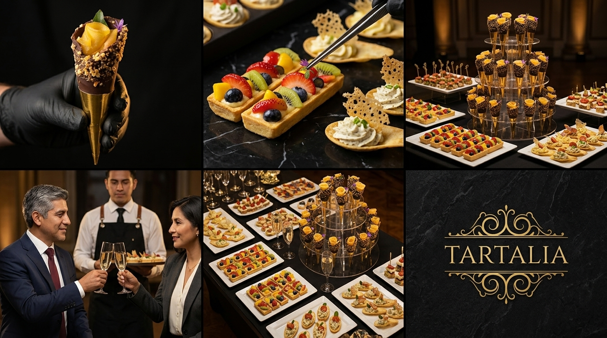

# STORYBOARD CINEMATOGRÁFICO: CHEF'S TABLE INSTITUCIONAL

**Proyecto:** `0001-chefs-table-institucional`  
**Workspace:** `tartalia` (Alta Cocina & Catering de Autor)  
**Reparto (Lore):** [[torre-conos-dorados]] (Signature Prop) | **Extras Visuales:** [[salonero-gala]], [[ejecutivo-corporativo]] (100% No Dialogantes)  
**Formato:** Master 16:9 Cinematográfico (Adaptable a 9:16)  
**Duración Total:** 34 Segundos  
**Estilo Visual:** Haute Cuisine Netflix *Chef's Table* documentary style, 120fps slow-motion, warm golden chiaroscuro lighting over dark obsidian marble, luxury corporate banquet scale, Hasselblad/ARRI Alexa 65 cinematic aesthetic, 8k resolution.  

---

## 🎨 Bloque 1: Tomas 1 a 5 (Secuencia Completa)

### Prompt Visual Global del Bloque
*LORE GLOSSARY:*  
*[[torre-conos-dorados]] = An authentic grand catering buffet station featuring a multi-tier clear acrylic tiered tower filled with individual Tartalia signature dessert cones (slender cones with shiny gold foil sleeves, dark chocolate coating, crushed toasted praline nut rims, and rolled golden fruit roses with purple petals), surrounded on the banquet table by elegant white porcelain platters displaying fresh fig boat canapés, golden fruit tartlets with vibrant red pomegranate seeds, and gourmet bamboo skewers.*  
*[[salonero-gala]] = Professional Bolivian banquet head waiter with neat short dark hair, wearing a crisp white dress shirt, long black bistro apron with leather straps, and black service gloves.*  
*[[ejecutivo-corporativo]] = Distinguished senior Bolivian corporate executive in his mid-40s with salt-and-pepper hair, wearing a bespoke midnight-navy tailored suit, burgundy tie, holding a champagne flute in soft focus.*  

*PROMPT:*  
*A 6-panel comic-style storyboard layout (2 rows of 3 panels), authentic luxury catering commercial style, 8k resolution, Hasselblad medium format food photography, warm golden chiaroscuro lighting on dark elegant backgrounds.*  
*Panel 1: Extreme macro close-up shot of a black-gloved hand gently holding Tartalia's signature gourmet cone: a slender cone wrapped in shiny metallic gold foil sleeve at the base, coated in rich dark chocolate with a rim encrusted with finely chopped toasted roasted nuts and praline, filled with an exquisite rolled golden mango-peach fruit rose, crowned with a tiny vibrant purple edible flower petal and a micro-green leaf, dramatic golden chiaroscuro lighting on dark background.*  
*Panel 2: Macro close-up on a dark marble counter displaying Tartalia's authentic signature catering appetizers matching reference image 2: an elongated rectangular golden pastry boat tartlet filled with vanilla custard cream and topped with neatly sliced fresh red strawberries, emerald kiwi slices, dark glossy blueberries and mango cubes; right beside it, elegant edible spoon-shaped cracker canapés with piped savory herb cream cheese mousse and a delicate crisp parmesan lace tuile, with a chef's precision tweezer placing a fresh micro-garnish.*  
*Panel 3: A magnificent and authentic catering buffet station based strictly on the loaded reference image: a multi-tier clear acrylic spiral tower holding signature cones with dark chocolate rims and fruit roses, surrounded on the banquet table by white porcelain platters loaded with fresh fig boat canapés, golden round tartlets with cream and bright red pomegranate seeds, and bamboo skewers in a prestigious hall.*  
*Panel 4: Medium cinematic shot in an upscale corporate gala reception. Two distinguished corporate leaders clinking two crystal champagne flutes together in a celebration toast: on the left, our casted Bolivian male executive matching reference image 3 (handsome mid-40s, neatly styled salt-and-pepper hair, tailored dark navy suit, burgundy tie); on the right, a distinguished Bolivian female banking vice-president in her early 40s with chic styled dark hair, tailored dark charcoal blazer and ivory silk blouse. In the soft-focus background between them, an attentive professional waiter in a crisp white shirt and black bistro apron holds a sleek service tray with Tartalia gourmet canapés. Warm ambient cocktail lighting, refined B2B networking atmosphere.*  
*Panel 5: High-angle overhead shot looking down at the abundant banquet table with crystal stemware and gourmet appetizers under warm focal lighting.*  
*Panel 6: Luxury brand emblem frame, dark textured obsidian stone with an ornate gold baroque filigree seal in the center matching Tartalia brand logo.*  
*CRITICAL: Do not include any text, letters, subtitles, words, or speech bubbles anywhere in the image. The image must be completely free of typography.*  

---

## 🎬 Desglose Técnico Toma por Toma

### Toma 1 (Hook Sensorial: Macro Cono Insignia)
- **Toma:** 1
- **Thumbnail (Visual):** Mano enguantada en negro sosteniendo el cono insignia de Tartalia: base en cono dorado metalizado brillante, cuerpo bañado en chocolate negro espeso, borde superior generosamente rebozado en crocante de frutos secos y almendras tostadas finamente picadas, y coronado con una delicada rosa de lámina de fruta dorada (mango/durazno), diminuto pétalo morado silvestre y micro-hoja verde. Push-in macro milimétrico revelando el brillo del chocolate y la textura del praliné. *(Panel 1 - Basado directamente en `cono_real_chocolate_rosa_fruta.jpg` / `WhatsApp Image 2026-10-24 at 9.24.30 AM (3).jpeg`)*
- **Acción/Narrativa:** Gancho sensorial de alta pastelería que establece de golpe la autenticidad, exquisitez y factura artesanal de Tartalia.
- **Cámara y Fotografía:**
  - **Plano:** ECU (Extreme Close-Up) / Lente 100mm f/2.8 Macro a 120fps slow-motion
  - **Movimiento de cámara:** Push-in milimétrico hiper-estable hacia el detalle de la rosa de fruta y el borde de praliné
  - **Iluminación:** Chiaroscuro lateral cálido dorado (Rim light dorada recortando el cono contra fondo negro obsidiana)
  - **Color Grading:** Negros profundos absolutos, oro metálico brillante, chocolate oscuro brillante y dorado ámbar de la fruta
- **Duración:** 6s (0:00 - 0:06)
- **Audio/Voz en Off:** *(Foley: Crujido sutil y nítido de chocolate templado y praliné crujiente)* "En las mesas donde se toman las decisiones más importantes..."
- **Transición:** Match Cut en textura y brillo dorado hacia la Toma 2

---

### Toma 2 (La Joyería del Bocado: Dúo de Barqueta Frutal & Cucharitas Crocantes)
- **Toma:** 2
- **Thumbnail (Visual):** Auténtico dúo de autor de Tartalia sobre mármol negro veteado: en primer término, una barqueta rectangular alargada de hojaldre dorado crujiente con crema pastelera y mosaico de frutillas rojas frescas, kiwi esmeralda, arándanos azules y mango glaseado; al lado, cucharitas comestibles de masa fina crujiente con mousse de queso a las finas hierbas y teja translúcida de queso parmesano coral. Pinza de chef de precisión quirúrgica depositando una micro-hoja fresca sobre el bocado. *(Panel 2 - Basado directamente en `catering_caja_canapes_reales.jpg` / `473993032_1425309472022701_3236245884576698123_n.jpg`)*
- **Acción/Narrativa:** Muestra el cuidado artesanal y la delicadeza con la que se construye cada pieza gastronómica de Tartalia.
- **Cámara y Fotografía:**
  - **Plano:** Detail Shot / Macro / Lente 85mm f/1.8
  - **Movimiento de cámara:** Slider lateral suave de izquierda a derecha con rack focus sutil
  - **Iluminación:** Luz suave cenital difusa con reflejos especulares en el glaseado brillante de las frutas y la superficie del mármol
  - **Color Grading:** Rojo brillante de frutillas, verde esmeralda de kiwi, azul profundo de arándanos, dorado de masa sableé y negro mármol profundo
- **Duración:** 7s (0:06 - 0:13)
- **Audio/Voz en Off:** *(Foley: Toque metálico fino de pinza + crujido sutil de masa horneada)* "...el verdadero poder no se impone. Se saborea en cada detalle."
- **Transición:** Speed Ramp suave acelerando hacia la apertura del salón en Toma 3

---

### Toma 3 (La Metamorfosis y Escala: Salón Monumental & Torre Acrílica)
- **Toma:** 3
- **Thumbnail (Visual):** Estación monumental y auténtica de catering: torre escalonada acrílica de conos dorados y de chocolate con rosas de frutas, flanqueada sobre la mesa por platones blancos con barquetas de higos frescos, tartaletas doradas crujientes con crema y semillas de granada roja rubí, y brochetas gourmet de bambú. Saloneros con delantal negro de lino en coreografía protocolar. *(Panel 3 - Basado directamente en `estacion_torre_conos_y_tartaletas_real.jpg`)*
- **Acción/Narrativa:** De la escala íntima del bocado pasamos a la abundancia auténtica y tangible de un banquete de gala institucional real.
- **Cámara y Fotografía:**
  - **Plano:** Wide to Medium-Wide / Lente 35mm f/2.8 Anamórfico
  - **Movimiento de cámara:** Grúa o jib en movimiento vertical ascendente y paneo rotacional envolvente
  - **Iluminación:** Combinación de luz cálida de candelabros neoclásicos con la luz crepuscular dorada-azulada de La Paz
  - **Color Grading:** Contraste majestuoso entre la calidez dorada del interior y el atardecer andino
- **Duración:** 8s (0:13 - 0:21)
- **Audio/Voz en Off:** *(Foley: Murmullo refinado de salón diplomático + crescendo de cuerdas orquestales)* "Transformamos salones institucionales en experiencias de gala inolvidables..."
- **Transición:** Corte por movimiento siguiendo el desplazamiento de una bandeja de servicio hacia los invitados

---

### Toma 4 (Estatus B2B y Tranquilidad: Brindis de Gala)
- **Toma:** 4
- **Thumbnail (Visual):** Dos altos líderes corporativos (nuestro [[ejecutivo-corporativo]] con traje azul medianoche, corbata borgoña y cabello entrecano, junto a una distinguida directora ejecutiva bancaria en elegante blazer sastre oscuro y blusa de seda marfil) brindan haciendo chocar dos copas de cristal con vino espumante (*CLINK*). En segundo plano y en elegante desenfoque (*soft focus*), el [[salonero-gala]] con delantal negro de lino sostiene una bandeja de servicio con bocaditos de Tartalia. Cero diálogo en cámara ni movimiento labial; distinción, éxito y satisfacción institucional. *(Panel 4)*
- **Acción/Narrativa:** Comunica la tranquilidad total y el estatus que Tartalia otorga al organizador y a las entidades anfitrionas.
- **Cámara y Fotografía:**
  - **Plano:** MS (Medium Shot) con profundidad de campo reducida / Lente 50mm f/1.4
  - **Movimiento de cámara:** Paneo horizontal flotante muy pausado a la altura de las copas
  - **Iluminación:** Iluminación suave de cóctel de gala con destellos en las facetas del cristal
  - **Color Grading:** Tonos azules marinos medianoche en trajes, champán dorado brillante y tonos de piel naturales
- **Duración:** 7s (0:21 - 0:28)
- **Audio/Voz en Off:** *(Foley: Tintineo de copas de cristal cortado CLINK puro)* "...con la precisión, puntualidad y excelencia que el prestigio de tu marca exige."
- **Transición:** Disolvencia pausada hacia cenital de mesa imperial

---

### Toma 5 (Cierre y Factor Prestigio: Placa Institucional de Autor)
- **Toma:** 5
- **Thumbnail (Visual):** Plano cenital lento alejándose sobre la mesa imperial perfectamente servida; transición limpia sobre fondo negro obsidiana donde resplandece en oro bruñido el emblema barroco de Tartalia. *(Paneles 5 y 6)*
- **Acción/Narrativa:** Cierre memorable de autor que fija la marca y su promesa en la mente de los tomadores de decisiones.
- **Cámara y Fotografía:**
  - **Plano:** High Angle / Overhead Cenital en pull-out lento / Lente 24mm f/2.8
  - **Movimiento de cámara:** Elevación cenital suave alejándose de la mesa hacia la oscuridad estética
  - **Iluminación:** Spotlight cenital enfocado en el centro del montaje que se desvanece suavemente
  - **Color Grading:** Negro obsidiana puro y oro imperial bruñido con destello sutil
- **Duración:** 6s (0:28 - 0:34)
- **Audio/Voz en Off:** *(Foley: Resonancia cálida de piano neoclásico)* "Tartalia. Lo bello puede ser exquisito... Haz que tu próximo evento sea legendario."
- **Transición:** Fade to black final
