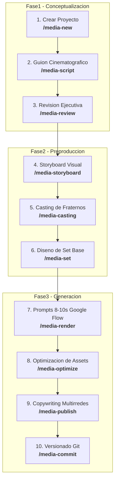

# Workspace: Tinkus Wistus - Filial Cochabamba (`wistus-cocha`)

> **FUERZA, RITMO Y HERMANDAD ANDINA** · *El corazón del Tinku en la Llajta.*
> 
> Workspace oficial de la **Fraternidad Folklórica y Cultural Tinkus Wistus - Filial Cochabamba**, especializado en la producción audiovisual cinematográfica, campañas de reclutamiento viral para nuevos fraternos, y cobertura épica del Carnaval de Oruro y el Corso de Corsos de Cochabamba.

---

## 🏢 Descripción General e Historia

La **Fraternidad Folklórica Cultural Tinkus Wistus** nació el **20 de septiembre de 1992** en la ciudad de La Paz, impulsada por jóvenes universitarios con la visión de revalorizar el ritual ceremonial andino del Norte de Potosí. Tras ganar el primer lugar en la Entrada Universitaria de 1994, Wistus transformó el folclore boliviano convirtiendo el Tinku en un fenómeno juvenil masivo. Desde 1996, la fraternidad participa ininterrumpidamente en el **Carnaval de Oruro** (Obra Maestra del Patrimonio Oral e Intangible de la Humanidad) bailando con devoción inquebrantable ante la Virgen del Socavón.

La **Filial Cochabamba** representa la fuerza, alegría y vitalidad de la juventud valluna, consolidándose como una de las agrupaciones más aclamadas y esperadas en el **Corso de Corsos** de Cochabamba y en las festividades folclóricas departamentales.

### Objetivos Audiovisuales del Workspace
1. **Videos Cinematográficos de Danza:** Capturar la potencia física, el zapateo atronador, el vuelo de las plumas de montera y la mística ceremonial del Tinku con estética de medio formato y cámaras de cine (ARRI Alexa, 60/120fps, iluminación chiaroscuro y golden hour).
2. **Campañas Virales de Reclutamiento:** Anuncios de alta conversión con técnicas de neuromarketing para convocar a nuevos bailarines (varones y mujeres) a los bloques de Cochabamba para Oruro y Corso de Corsos.
3. **Piezas Editoriales y Fine-Art:** Publicaciones y artes estáticos (**`/media-post`**) libres de clichés de volante tradicional, con fotografía editorial de alta gama.
4. **Cobertura de Fiestas Mayores:** Despliegue de micro-videos y series documentales para el Carnaval de Oruro y el Corso de Corsos en Cochabamba.

---

## 🎨 Identidad de Marca y Activos Analizados

| Elemento | Especificación / Valor |
|---|---|
| **Morado Institucional (Primario)** | `#760386` (Púrpura oficial Wistus presente en trajes y logotipo) |
| **Blanco Puro (Secundario)** | `#FFFFFF` (Tipografía, ribetes y contraste limpio) |
| **Dorado Solar Inti (Acento)** | `#FFB800` / `#F9B820` (Bordados, tocapus y estampados vectoriales) |
| **Magenta / Fucsia Andino (Acento)** | `#BC1669` (Plumas de montera y flores tradicionales) |
| **Azul Noche / Añil (Acento)** | `#19106B` (Trajes nocturnos y fondos de alto contraste) |
| **Tipografía de Título** | Montserrat (Black 900 / Bold 700) |
| **Tipografía de Contenido** | Inter (Regular 400 / Medium 500) |
| **Lema Oficial** | *"FUERZA, RITMO Y HERMANDAD ANDINA"* · *"El corazón del Tinku en la Llajta"* |

### 📂 Inventario de Assets Incorporados
- **Logotipos Oficiales (`assets/brand/logos/`):**
  - `wistus-logo-filial-cocha-morado.png` (Versión púrpura `#760386`)
  - `wistus-logo-filial-cocha-blanco.png` (Versión blanca `#FFFFFF`)
  - `logo.png` (Referencia raíz oficial del workspace)
- **Isotipos y Estampados Vectoriales (`assets/brand/isotipos/`):**
  - `estampados-01.png` a `estampados-04.png`: Escudos e íconos solares/chakana para pecheras y espaldas.
  - `estampados-05.png` y `estampados-06.png`: Guardas textiles andinas (tocapus geométricos) para mangas, fajas y pantalones.
  - `estampados.ai`: Archivo vectorial maestro original.
- **Galería Fotográfica de Referencia (`assets/brand/fotos/`):**
  - 16 fotografías oficiales analizadas que documentan trajes de gala, monteras, expresiones de bailarines y estética de presentaciones.

---

## 🎬 Flujo de Trabajo en Media-Architect

El ciclo de producción para Tinkus Wistus sigue el pipeline estandarizado del framework:

---

## 📁 Estructura del Directorio
- `DOSSIER.md`: Documento maestro con toda la investigación antropológica, historia de Wistus, análisis técnico de activos gráficos y estrategias de contenido.
- `workspace.yaml`: Configuración de marca, colores analizados, políticas de audio y parámetros de IA.
- `AGENTS.md`: Contexto creativo, los 8 roles de la IA, arquetipos de video y directrices de neuromarketing.
- `projects/`: Proyectos audiovisuales de video (ej. `0001-fuerza-wistus-corso-cocha`).
- `characters/`: Fichas y Hojas de Referencia (**Reference Sheets**) de fraternos y bailarines modelo.
- `posts/`: Publicaciones estáticas virales, convocatorias de inscripción y piezas de diseño editorial (**`/media-post`**).
- `assets/`: Logotipos, estampados vectoriales y fotografías de referencia de Wistus Filial Cochabamba.
