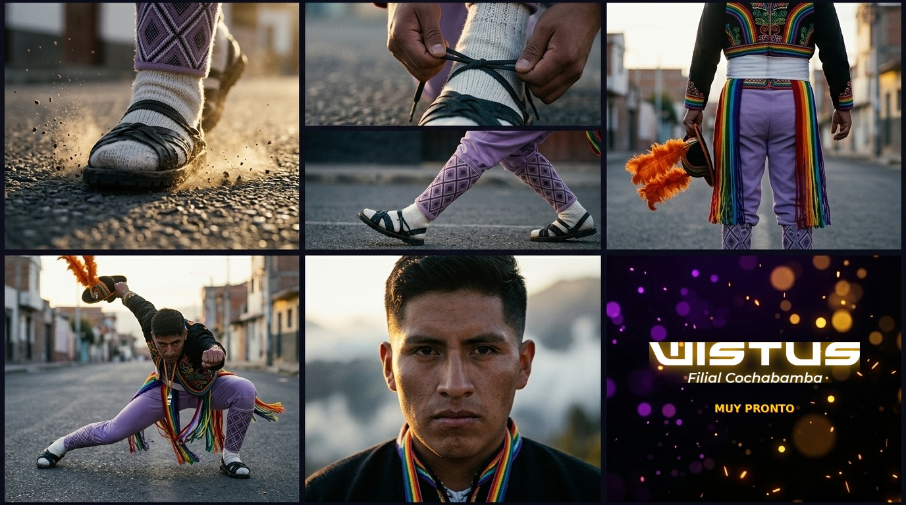

# STORYBOARD CINEMATOGRÁFICO: Tráiler de Expectativa - El Primer Paso

**Proyecto:** `0001-el-primer-paso`  
**Workspace:** `wistus-cocha`  
**Reparto (Lore):** `mateo` (Joven Fraterno Urbano de Cochabamba)  
**Formato:** Vertical (9:16) para TikTok, Instagram Reels y YouTube Shorts  
**Duración Total:** 13 segundos (Hiper-Dinámico / Montaje Percusivo a 125 BPM)  
**Locación Principal:** [sets/set_01_asfalto_cochabamba.md](../sets/set_01_asfalto_cochabamba.md)  

---

## 🎨 Bloque 1: Tomas 1 a 5 (Guion Completo - 13 Segundos)

*LORE GLOSSARY:*  
*[mateo] = 22-year-old Bolivian urban athletic male from Cochabamba, clean taper fade haircut, dark brown eyes, light-tan valley complexion, clean-shaven with intense proud gaze, wearing authentic Bolivian Tinku gala festival attire: tailored black chaquetilla jacket densely adorned with multicolor geometric starburst and floral embroidery, fuchsia cuffs, cascading rainbow-striped aguayo fringe ribbons hanging from the waist over lavender-violet trousers, hand-knitted multicolor diamond-patterned woolen polainas, thick white hand-knitted woolen socks completely covering ankles and feet, authentic rustic black recycled tire-tread rubber abarcas sandals tied with criss-crossed rubber straps and knotted cord ties (NO buckles, NO metal, 100% rustic tire rubber and cord craft) worn OVER the white socks (NEVER bare feet, NO bare legs), and holding a traditional combat leather montera helmet with cowhide texture, small circular mirrors, and a tall bright orange feather plume.*

*PROMPT GLOBAL DE STORYBOARD:*  
*Cinematic High-End Commercial and documentary style, ARRI Alexa 35mm look, ground-level macro, dramatic chiaroscuro, cold dawn transitioning to golden amber lighting, authentic Bolivian Tinku gala costume, black chaquetilla densely adorned with multicolor geometric embroidery, fuchsia cuffs, cascading rainbow-striped aguayo fringe strips, lavender trousers, hand-knitted diamond-patterned polainas, thick white wool socks, authentic rustic black tire-tread abarcas, slow-motion 120fps stomping dust particles, photorealistic 8k, subtle 35mm film grain. A 6-panel comic-style storyboard layout (2 rows of 3 vertical panels) illustrating the sequence of an epic action teaser trailer in Cochabamba:*  
*- Panel 1: Extreme ground-level macro close-up on the rough textured asphalt of a Cochabamba street at dawn. An authentic rustic black recycled tire-tread abarca sandal (thick grooved tire rubber sole, tied rubber straps) worn OVER a thick white hand-knitted woolen sock stomps aggressively onto the pavement in slow motion, erupting a violent shockwave of fine Andean dust and flying micro-pebbles catching golden morning rim light. Lavender trousers and colorful diamond-patterned polainas visible on the lower leg. NO bare skin, NO bare feet, foot is fully covered in thick white wool sock.*  
*- Panel 2: Rapid montage detail shot: masculine hands firmly adjusting, tightening and wrapping the rustic tied rubber straps and knotted cord ties of the black recycled tire-tread abarca OVER the thick white knitted woolen sock (no metal buckles, authentic hand-cut tire craft). In the adjacent framing, colorful hand-knitted woolen polainas with geometric diamond patterns stretch over the lavender-violet trousers and white socks during a rapid rhythmic step. NO bare skin, completely clothed in authentic Andean textiles.*  
*- Panel 3: Medium shot from behind of [mateo] on an empty Cochabamba cobblestone-asphalt avenue at dawn. Clearly visible is the back of his black traditional jacket featuring the yellow embroidered Wistus emblem, bold rainbow embroidered 'WIST'US' lettering, a white lumbar sash with 'WIST'US BICENTENARIO', and long rainbow textile fringes cascading down over lavender trousers, diamond polainas, white socks, and abarcas. In his right hand ONLY, he holds ONE SINGLE traditional leather montera helmet with vibrant orange feather plumes at thigh level. His left hand is completely empty, open and relaxed at his side. ONLY ONE SINGLE MONTERA in the entire frame, do NOT duplicate or place a second helmet in the other hand.*  
*- Panel 4: Dramatic low-angle dynamic combat action shot of [mateo] in the authentic Tinku combat posture: torso leaning aggressively forward in a deep combat lunge, his right arm raised high into the air brandishing the leather montera helmet with vibrant orange feather plumes towards the sky, while thrusting his left clenched fist directly towards the camera lens in a fierce martial challenge. Wearing full gala attire (black embroidered jacket, lavender trousers, cascading rainbow-striped aguayo fringe strips, colorful diamond polainas, white socks, and rustic black tire-tread abarcas). Chin up, intense fiery warrior expression, against a cold dawn sky with golden sunlight catching the Tunari mountains in the background.*  
*- Panel 5: Cinematic tight close-up of [mateo]'s determined, proud facial expression and dark eyes, golden dawn rim light highlighting his clean taper fade hair, woven ribbon lanyard with whistle around collar, and natural skin texture, mountain mist swirling softly behind him.*  
*- Panel 6: Cinematic graphic title card on a deep black background with soft floating volumetric purple (#760386) and golden embers: Centered is the official corporate brand logo of the fraternity: the bold stylized geometric wordmark 'WISTUS' with 'Filial Cochabamba' underneath, rendered in elegant glowing pure white (#FFFFFF) with a warm subtle Inti gold (#FFB800) and royal purple rim glow, accompanied by the minimalist text 'MUY PRONTO'.*  
*CRITICAL MANDATORY CULTURAL RULE: NO metal buckles. Abarcas are rustic, hand-cut from recycled truck tire tread with tied rubber straps and knotted cord loops. NO bare feet, NO bare legs, NO bare toes. All feet and ankles must be completely covered in thick white hand-knitted woolen socks inside the black abarcas. The character carries ONLY ONE single montera helmet. In Panel 4, he brandishes the montera high overhead with one arm while punching forward with the other fist in classic Tinku stance. In Panel 6, display the official geometric WISTUS Filial Cochabamba logo wordmark. Do not include speech bubbles or random subtitles.*

---

### Toma 1 (Hook de Shock: El Retumbar)
- **Toma:** 1
- **Thumbnail (Visual):** Primer plano macro extremo a ras del asfalto de Cochabamba; una abarca rústica tradicional de llanta de camión con suela dentada y tiras de goma, calzada sobre una gruesa calceta de lana blanca, estalla violentamente contra la calzada a 120fps, proyectando una nube cónica de arenilla y polvo andino con sacudida sísmica de cámara.
- **Acción/Narrativa:** Entrada agresiva en el milisegundo 0:00 sin introducciones lentas. El zapateo quiebra el silencio con fuerza marcial, atrapando inmediatamente la atención en TikTok/Reels.
- **Cámara y Fotografía:**
  - **Plano:** ECU (Extreme Close-Up) / Macro a ras de suelo (Ground-Level) / Lente 100mm Macro Cine, f/11
  - **Movimiento de cámara:** Estática fija con vibración sísmica post-impacto (*camera shake* de 0.2s)
  - **Iluminación:** Luz rasante lateral dorada de amanecer skimming sobre la rugosidad del asfalto frío
  - **Color Grading:** Sombras azul índigo andino profundo en las hendiduras y destellos ámbar cálido en las partículas de polvo
- **Duración:** 0:00 - 0:01.5 (1.5 segundos)
- **Audio/Voz en Off:** "¡BOOM! Golpe demoledor de bombo andino y bass drop en el milisegundo cero. Sonido seco, mineral y expansivo contra la piedra."
- **Transición:** Whip pan veloz y rítmico hacia Toma 2

---

### Toma 2 (Preparación Rápida: Acomodar la Abarca)
- **Toma:** 2
- **Thumbnail (Visual):** Planos detalle en ráfaga continua: manos morenas acomodando y verificando con firmeza el calce de la tira de la abarca rústica de llanta sobre la gruesa calceta blanca de lana (asegurando que no se saldrá al zapatear), con las chalinas de aguayo y flecos blancos cayendo sobre sus piernas; corte instantáneo a la polaina de lana tejida con rombos geométricos multicolores estirándose sobre el gemelo con un paso acelerado y enérgico.
- **Acción/Narrativa:** El ritual de vestirse para la danza como preparación para la batalla; acomodar la abarca de caucho de neumático y comprobar que esté perfectamente firme y calzada para resistir los impactos violentos del zapateo. Precisión y disciplina marcial a 125 BPM.
- **Cámara y Fotografía:**
  - **Plano:** CU (Close-Up) y Detail Shot / Lente 50mm Prime, f/2.0
  - **Movimiento de cámara:** Paneo rápido (Whip Pan) continuo conectando manos y piernas
  - **Iluminación:** Luz lateral direccional de sol naciente que realza el relieve táctil de la lana y la textura porosa de la goma de neumático
  - **Color Grading:** Saturación vibrante y contrastada en los rombos de las polainas (fucsia, turquesa, amarillo) sobre fondos de asfalto neutro
- **Duración:** 0:01.5 - 0:03.5 (2.0 segundos)
- **Audio/Voz en Off:** "SFX Whoosh de aire veloz, crujido elástico de goma tensada y el pulso cardíaco de la percusión a 125 BPM."
- **Transición:** Match Cut dinámico de movimiento hacia Toma 3

---

### Toma 3 (La Armadura: Identidad Wistus en la Espalda)
- **Toma:** 3
- **Thumbnail (Visual):** Plano medio dorsal en barrido vertical; la cámara recorre la espalda de la chaquetilla negra de gala con el escudo amarillo de Wistus, el bordado arcoíris 'WIST'US', la faja lumbar blanca 'WIST'US BICENTENARIO' con tiras de telar andino multicolor, descendiendo hacia la mano derecha que sostiene la montera con penacho de plumas naranja ondeando con el viento frío.
- **Acción/Narrativa:** Revelación de la insignia y la pertenencia a la Fraternidad; el bailarín porta su indumentaria con solemnidad y orgullo mientras las plumas de suri respiran vida.
- **Cámara y Fotografía:**
  - **Plano:** MS (Medium Shot) Dorsal en barrido vertical hacia mano / Lente 35mm Cine, f/1.8
  - **Movimiento de cámara:** Tilt Down ágil y fluido desde el escudo dorsal hacia la montera
  - **Iluminación:** Contraluz dorado de amanecer (Rim Light) recortando la silueta de las plumas de suri y el relieve del bordado
  - **Color Grading:** Negros de bayeta puros y profundos con destellos multicolores en los hilos de seda
- **Duración:** 0:03.5 - 0:06 (2.5 segundos)
- **Audio/Voz en Off:** "SFX Rasgueo seco, veloz y agresivo de charango andino a tempo rápido, marcando el pulso cardíaco de la escena."
- **Transición:** Snap Zoom / Whip Pan con giro rápido de cuerpo hacia Toma 4

---

### Toma 4 (La Guardia Marcial: El Desafío)
- **Toma:** 4
- **Thumbnail (Visual):** Plano medio contrapicado de [mateo] en la postura de combate tradicional y auténtica del Tinku: torso inclinado agresivamente hacia adelante en una zancada profunda, alzando su brazo derecho en alto empuñando la montera hacia el cielo con el penacho de plumas naranja al viento, mientras lanza su puño izquierdo cerrado con fiereza directamente hacia la cámara. Mentón en alto, mirada penetrante y desafiante; las tiras de telar multicolor arremolinándose con la fuerza del movimiento frente a la cordillera del Tunari.
- **Acción/Narrativa:** El protagonista se planta ante el espectador en la pose guerrera icónica del Tinku; la fuerza combativa ancestral y la elegancia contemporánea de los Wistus convergen en una pose de poder y desafío absoluto.
- **Cámara y Fotografía:**
  - **Plano:** MLS (Medium Long Shot) en ángulo contrapicado dinámico (Low Angle) / Lente 35mm Cine, f/2.2
  - **Movimiento de cámara:** Push-in rápido y firme hacia la mirada y el puño de [mateo], deteniéndose en seco con el golpe del zapateo
  - **Iluminación:** Contraluz dramático de amanecer con sutil luz de relleno suave en el rostro, destacando el corte taper fade y la mirada
  - **Color Grading:** Calidez dorada en los bordes corporales, atmósfera de neblina matinal del valle
- **Duración:** 0:06 - 0:09 (3.0 segundos)
- **Audio/Voz en Off:** "SFX Segundo impacto de bombo con eco monumental y grito lejano y gutural de tropa: «¡WISTUS!»."
- **Transición:** Hard Cut súbito a negro con estallido de destellos dorados hacia Toma 5

---

### Toma 5 (Remate & Hype: El Gigante Vuelve)
- **Toma:** 5
- **Thumbnail (Visual):** Fondo negro puro cinematográfico con partículas doradas y violetas flotantes en suspensión; emerge en el centro el logotipo oficial de **WISTUS Filial Cochabamba** (con su tipografía geométrica estilizada) en blanco puro resplandeciente con halo dorado Inti (#FFB800) y morado imperial (#760386), acompañado por el remate enigmático: 'EL GIGANTE VUELVE A PISAR FUERTE / MUY PRONTO'.
- **Acción/Narrativa:** Cierre de máxima expectativa viral (*cliffhanger*); firma de marca que sella el retorno de la Fraternidad en Cochabamba y desata la intriga y los comentarios en la comunidad.
- **Cámara y Fotografía:**
  - **Plano:** Graphic Title Screen / Official Wordmark Reveal centrado
  - **Movimiento de cámara:** Zoom óptico lento y majestuoso hacia adelante (Slow Optical Drift)
  - **Iluminación:** Resplandor volumétrico interno emanando del logotipo oficial
  - **Color Grading:** Blanco luminoso, morado imperial (#760386) y oro metálico (#FFB800) sobre negro absoluto
- **Duración:** 0:09 - 0:13 (4.0 segundos)
- **Audio/Voz en Off:** "SFX Resonancia final del charango andino desvaneciéndose en reverberación profunda, seguido de un silencio total y absoluto."
- **Transición:** Fade Out elegante a negro final

---

## 📊 Matriz de Coherencia Audiovisual

| Toma | Código de Tiempo | Sujeto / Foco | Locación / Set Plate | Audio Principal |
| :--- | :--- | :--- | :--- | :--- |
| **1** | 0:00 - 0:01.5 | Abarca negra & impacto en asfalto a 120fps | `set_01_asfalto_cochabamba_macro.jpg` | Boom de bombo & sub-bass drop |
| **2** | 0:01.5 - 0:03.5 | Ajuste de abarcas y polainas de rombos | `set_01_asfalto_cochabamba_macro.jpg` | Percusión acelerada a 125 BPM & Whoosh |
| **3** | 0:03.5 - 0:06.0 | Chaquetilla dorsal 'WIST'US' & montera naranja | `set_01_asfalto_cochabamba_wide.jpg` | Charango andino enérgico y veloz |
| **4** | 0:06.0 - 0:09.0 | [mateo] en guardia marcial wist'u | `set_01_asfalto_cochabamba_wide.jpg` | Golpe de bombo & grito «¡WISTUS!» |
| **5** | 0:09.0 - 0:13.0 | Logotipo oficial Wistus Cocha & "MUY PRONTO" | Graphic Card / Black Void | Resonancia de charango & silencio |
